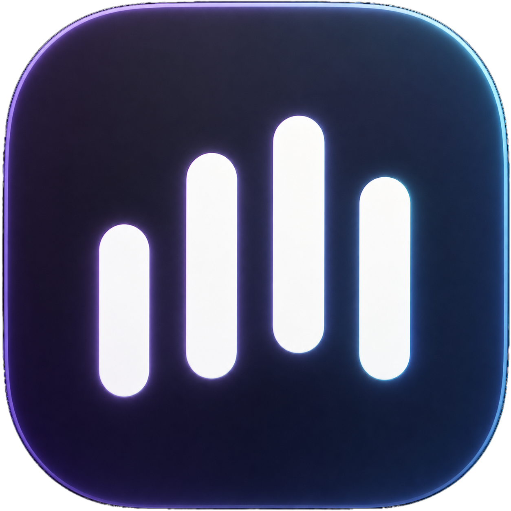
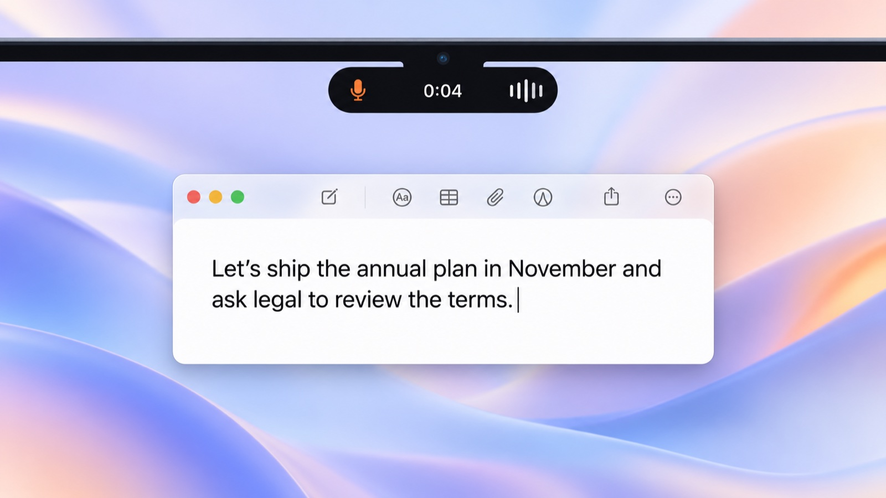
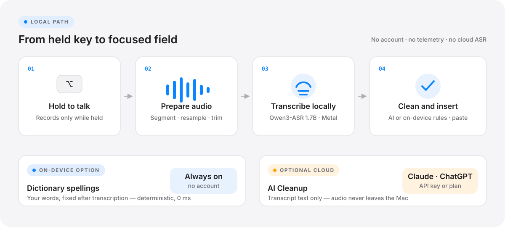
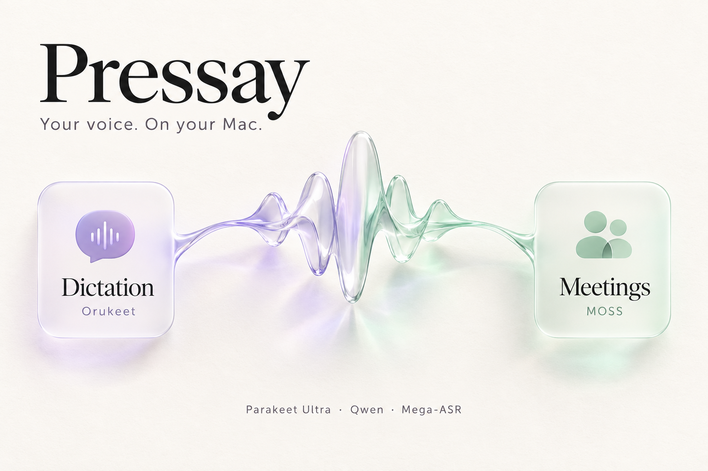
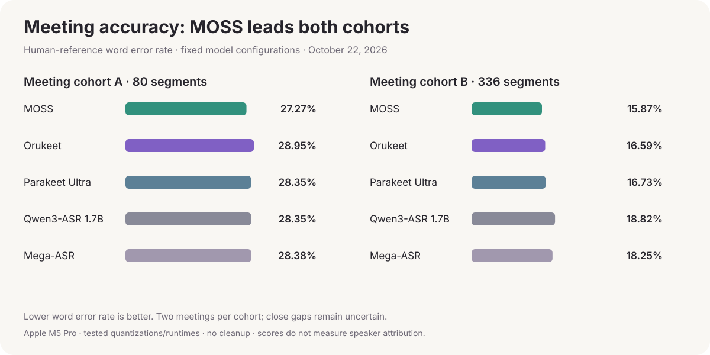
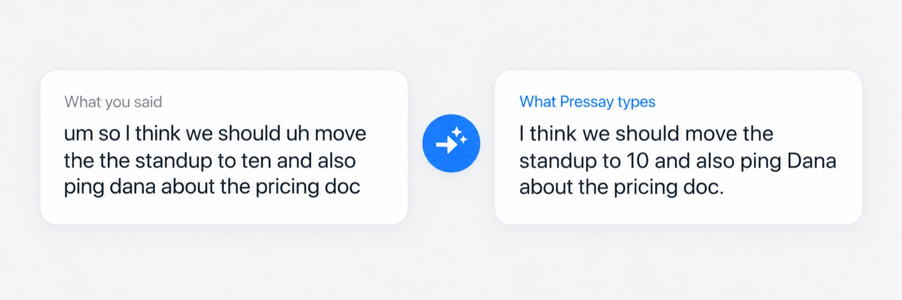
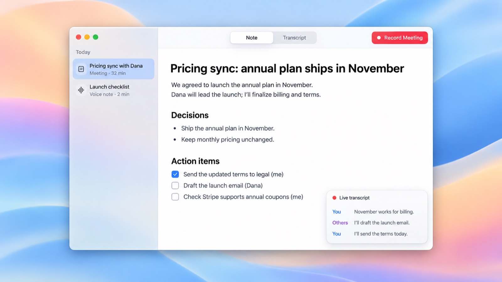

<p align="center">
  
</p>

<h1 align="center">Pressay</h1>

<p align="center">
  <strong>Private, quality-first voice dictation and meeting notes for macOS.</strong><br>
  Hold. Speak. Release. Your words appear at the cursor.
</p>

<p align="center">
  <a href="https://github.com/Zheruel/pressay-macos/actions/workflows/ci.yml"></a>
  
  
  <a href="LICENSE"></a>
</p>

Pressay is a native hold-to-talk dictation app for people who write to coding agents, chats and docs all day. Speech is transcribed on your Mac. Optional AI Cleanup, on your Claude or OpenAI subscription or API key, turns the transcript into clean text. Pressay also records meetings: a live on-device transcript of you and the call, then a written-up note.

No account, no telemetry, no subscription. Audio never leaves the Mac.

<p align="center">
  
</p>

> [!IMPORTANT]
> Requires an Apple Silicon Mac on macOS 26 or newer. Releases use free signing and are not Apple-notarized.

## Features

- **Dictation anywhere.** Hold Right Option (configurable), speak, release. The text lands in the field that was focused when you started, in native, web and Electron apps. The clipboard is preserved.
- **Local speech recognition for each task.** Orukeet is recommended for fast everyday dictation; MOSS for meeting accuracy. Ranked pickers also offer Parakeet Ultra, Qwen3-ASR 1.7B and Mega-ASR. All models use automatic language detection; fixed-language choices appear where the runtime supports them.
- **AI Cleanup (optional).** Fixes misheard words, removes fillers and false starts, and formats lists and paragraphs. Uses your Claude or OpenAI subscription or API key. Only text is sent.
- **Snippets.** Say "my calendar link" and Pressay types the URL. Works inside any dictation.
- **Notetaker.** Offers to take notes when a call starts. Records your mic as "You" and tells the other people on the call apart on-device (Speaker 1, Speaker 2, or their names), so it works with Zoom, Meet, Teams or Slack and no bot joins the call. When the call ends you get a titled note with a summary, decisions, action items with owners, and open questions. Ask anything about one meeting or all of them, and keep your action items in one list or send them to Reminders.
- **Your own dictionary.** Starts empty. Add names and terms yourself; Pressay never adds words automatically. Both the on-device rules and AI Cleanup use your entries.
- **Microphone lifecycle.** The microphone opens when you hold the talk key and closes when you release or cancel. The start sound plays once real audio arrives.
- **Graphite workspace.** A consistent dark and light interface with recent dictations, speaking pace, streak, personal action items, and combined Dictation/Notetaker settings under General.

## How it works

<p align="center">
  
</p>

Without AI Cleanup, a deterministic on-device pipeline applies the dictionary, cleans up common speech artifacts and, for longer dictations, adds punctuation, paragraphs and bullet lists. With AI Cleanup on, the model does that job. Terminals and dictations under ten words skip the AI: on short dictations it almost never changed anything. On a timeout, error or usage limit, Pressay inserts the on-device result.

## Transcription

<p align="center">
  
</p>

**Orukeet for dictation. MOSS for meetings.** Fresh installs use these task-specific defaults. Choose from five ranked local models in Settings; existing explicit choices and custom dictionaries are preserved. Models download on first use, and only the active model stays loaded. No Python installation is needed.

<p align="center">
  
</p>

We tested 27 models and reviewed 74 personal recordings before cleanup. MOSS led both public meeting cohorts; Orukeet was much faster. Personal recordings have no verified human transcripts, so there is no established personal dictation accuracy winner. Wispr transcripts were not ground truth. Exact configurations, the top ten and limitations: [`docs/benchmarks.md`](docs/benchmarks.md).

## AI Cleanup

<p align="center">
  
</p>

Choose **Claude** or **OpenAI**, then **Subscription** or **API key**, under **Settings › AI Cleanup**. Pressay chooses the model and reasoning level.

| Provider | Fixed cleanup model | Subscription connection |
| --- | --- | --- |
| Claude | Haiku 5.5, low reasoning | Your installed Claude Code CLI |
| OpenAI | GPT-6 Luna, medium reasoning, Fast | ChatGPT browser sign-in |
| None | On-device formatting | No account required |

Cleanup uses [Hex’s default prompt](https://github.com/anomalyco/hex). The dictionary starts empty and supplies only spellings you add manually. A replay of 20 personal transcripts and six controls favored medium reasoning for Luna; Haiku’s medium setting showed no consistent fidelity benefit. These are text-fidelity checks, not verified speech accuracy. The short prompt can still drop qualifications or alter meaning.

OpenAI prepares its WebSocket during recording and reuses it for cleanup, with HTTP fallback. Claude subscription cleanup prepares a fresh, unmodified Claude Code worker during local transcription. The worker receives text only when cleanup is needed; unused workers are cancelled. There are no dummy inference requests or shared conversation history. If cleanup fails or times out, Pressay keeps the local transcript.

API keys are stored in the macOS keychain. Subscription usage and API billing are separate.

Earlier cleanup comparisons remain in [`docs/claude-cleanup/`](docs/claude-cleanup/README.md); they do not validate the current prompt.

## Meeting notes

<p align="center">
  
</p>

When Zoom, Teams, Meet, FaceTime, Slack or another call app starts using the microphone, Pressay offers to take notes. You can also click **Start Notetaker** in the menu bar or on the Notetaker page of the Pressay window.

- A small notepad floats above your apps with the timer, the live transcript and your own notes.
- Your mic is recorded with echo cancellation. Call audio comes from a Core Audio process tap; the first meeting asks for **System Audio Recording** permission.
- An on-device voice activity model finds speech, even from quiet participants, and each utterance is transcribed on the Mac as soon as the speaker pauses.
- Up to four other voices are told apart on the Mac. After the call, the AI names a speaker only when they introduced themselves or were addressed by name, and fixes misheard names and terms using your Dictionary. Rename speakers from the meeting header.
- When the call ends (or you click **Stop**), the AI writes the note. Each meeting has **Summary**, **Transcript** and **My Notes** tabs, and an **Ask anything** box. Past meetings are grouped by day and searchable, and you can ask questions across all of them.
- **Action items** collects your open tasks across meetings. Complete them with the circular control, or add them to Reminders. Other assignments remain in each meeting note.
- Choose speech recognition, language, and the ranked notes model under **General › Notetaker**. Claude Sonnet 5.5 and GPT-6.1 Sol lead their provider lists. Meeting AI requires an Anthropic API key or a ChatGPT subscription connected in AI Cleanup; Claude Code subscriptions and OpenAI API keys currently support dictation cleanup only.
- Audio is never saved. Only the transcript and your notes go to the AI provider, to write the note or answer a question.

The meeting prompt was tuned over six blind-judged rounds on 12 meetings: [`docs/notes/meetings/`](docs/notes/meetings/README.md).

## Pressay vs. Wispr Flow

| | Pressay | Wispr Flow |
| --- | --- | --- |
| Speech recognition | On your Mac | Cloud |
| Audio leaves your Mac | Never | Yes |
| Account required | No | Yes |
| Price | Free, MIT. AI Cleanup uses your subscription or API key | Subscription |
| Meeting notes without a bot | Yes, on-device transcript | Yes |
| Works offline | Yes, without AI Cleanup | No |
| Platforms | macOS 26+, Apple Silicon | macOS, Windows, iOS |

## Privacy

| Data | Where it goes | Retention |
| --- | --- | --- |
| Microphone and call audio | Processed on the Mac only | Dictation audio 7 days by default; meeting audio never stored |
| Dictation transcript | On the Mac. Sent to your AI provider only if AI Cleanup is on | 30 days by default |
| Meeting transcript and your notes | On the Mac. Sent to your AI provider when you stop, to write the note | Until you delete the note |
| Text around the cursor | Read briefly to find the insertion target | Never stored |
| Telemetry | None | — |

The speech model downloads once from Hugging Face. After that, dictation works offline.

**Keep the microphone ready** keeps the audio stream open for 45 s after a dictation, so macOS shows the orange mic indicator during that time. Only a half-second ring buffer is kept, and it is overwritten continuously. The mic closes on sleep and screen lock, is never kept open on Bluetooth headphones (an open mic switches them to call audio), and the feature can be turned off in Settings.

## Install

Run this in Terminal to install the latest prebuilt release. No Xcode or Homebrew is needed:

```bash
curl -fsSL https://raw.githubusercontent.com/Zheruel/pressay-macos/main/scripts/install.sh | bash
```

The installer checks the release checksum and app signature before replacing anything. It installs into `~/Applications`, or updates `/Applications/Pressay.app` if that installation exists. Quit Pressay first; the installer will not interrupt a recording. To choose another writable folder, download and inspect the script, then run it with `PRESSAY_INSTALL_DIR` set to that folder.

Pressay asks for Microphone, Accessibility, and Input Monitoring permissions on first launch. It downloads the speech model on first use. Meeting recording also needs System Audio Recording permission.

When an update is available, a notice appears in Pressay’s sidebar and menu bar. Click **Update and restart** to download, verify, and install it. Pressay waits for active dictation, processing, or meeting recording to finish before restarting. You can also choose **Check for Updates…**, or turn off automatic checks under **General › App updates**. Checks contact GitHub; no telemetry is sent.

The [DMG download](https://github.com/Zheruel/pressay-macos/releases/latest) is also available. These builds are not Apple-notarized: a browser download may require **System Settings › Privacy & Security › Open Anyway** after the first launch attempt. Updating from an ad-hoc signed release (before stable release signing) asks for Microphone, Accessibility and Input Monitoring once more. If insertion or the hold key stops working, remove and re-add Pressay under the affected permission in System Settings, then reopen it.

### Build from source

Requirements: Apple Silicon, macOS 26+, Xcode 26+, CMake, the Xcode Metal Toolchain, and at least 8 GB of free space for builds and model caches. Orukeet needs about 715 MB; the optional Mega-ASR download is much larger.

```bash
git clone https://github.com/Zheruel/pressay-macos.git
cd pressay-macos
make test
make install
```

If Xcode reports a missing Metal Toolchain, install it with `xcodebuild -downloadComponent MetalToolchain`. The app build fetches pinned native runtimes and Swift MLX dependencies; these are bundled and signed, so end users install no extra tools.

`make app` builds `.build/Pressay.app` without installing; `make dmg` builds a disk image. On first launch Pressay asks for Microphone, Accessibility (to insert text) and Input Monitoring (for the hold key), then downloads and warms the speech model.

Without a paid Apple Developer account, builds are ad-hoc signed and macOS may ask for permissions again after each update. For stable permissions on one Mac, run once:

```bash
./scripts/create-local-signing-certificate.sh
```

## Dictionary

Add words under **Settings › Dictionary**, one per line. Optionally add what they get misheard as:

```text
Supabase
myRepository <= my repository
```

The dictionary starts empty and only contains words you add. Pressay does not learn from corrections or scan your history for new entries. Remove words from their context menu at any time.

## Development

```bash
make build
make test
```

```text
Sources/
├── PressayApp/             SwiftUI/AppKit app: audio, overlay, insertion, notes
├── PressayCore/            Cleanup, AI providers, vocabulary, prompts, retention
├── PressayTranscription/   Local worker lifecycle, model downloads, legacy ASR
├── PressayBench/           Transcription and cleanup benchmark CLI
└── TranscribeCpp/          Vendored Swift wrapper for the native runtime
```

CI runs the tests and a full app build on every pull request. Pushing a `vX.Y.Z` tag that matches `Config/Info.plist` publishes the DMG, installer ZIP, checksums, and signed update feed. Increment `CFBundleVersion` for every release so Sparkle can order updates. The release workflow requires `SPARKLE_PRIVATE_KEY` and the release signing certificate; see [release setup](docs/releases.md). The bundle identifier stays `dev.localflow.app`.

The separate `Runtime/` Swift package builds the bundled speech worker. Model data stays in Application Support; executable runtimes ship inside the signed app.

Benchmarks: [ASR](docs/benchmarks.md), [AI Cleanup](docs/claude-cleanup/README.md), [meeting notes](docs/notes/meetings/README.md). Keep audio, transcripts and API keys out of the repository. See [CONTRIBUTING.md](CONTRIBUTING.md).

## Known limitations

- macOS 26+ and Apple Silicon only.
- Speaker separation tells apart up to four other voices and works best on meetings under an hour; a line is occasionally given to the wrong person.
- Insertion relies on Accessibility; some custom editors behave differently.
- Accuracy varies with microphone, accent and noise. Review text before running destructive agent commands.
- No notarized binaries yet.

## Acknowledgements

- [transcribe.cpp](https://github.com/handy-computer/transcribe.cpp) for the ggml/Metal speech runtime.
- [Qwen3-ASR](https://huggingface.co/Qwen/Qwen3-ASR-1.7B), [Fun-ASR MLT Nano](https://huggingface.co/FunAudioLLM/Fun-ASR-MLT-Nano-2512), [Whisper Large V3 Turbo](https://huggingface.co/openai/whisper-large-v3-turbo) and [Voxtral Mini 3B](https://huggingface.co/mistralai/Voxtral-Mini-3B-2507) for the speech models.

See [THIRD_PARTY_NOTICES.md](THIRD_PARTY_NOTICES.md). Source code is [MIT](LICENSE); model weights keep their own licenses.
