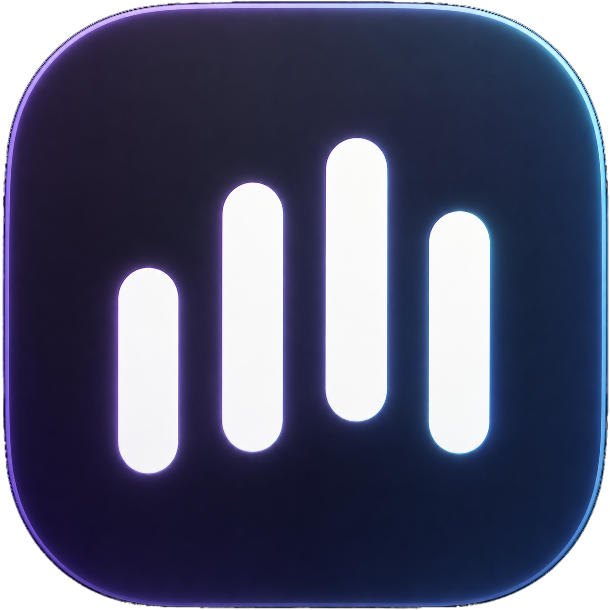
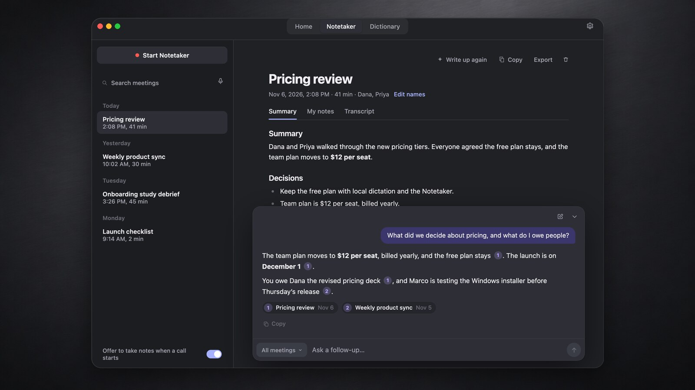
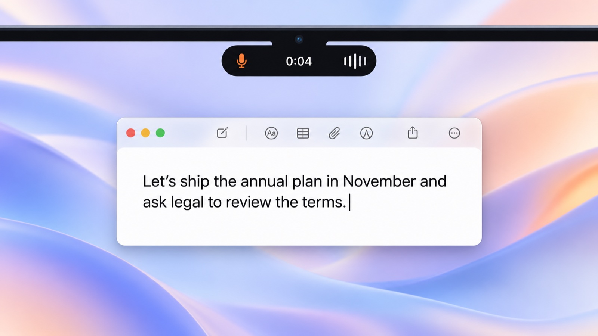
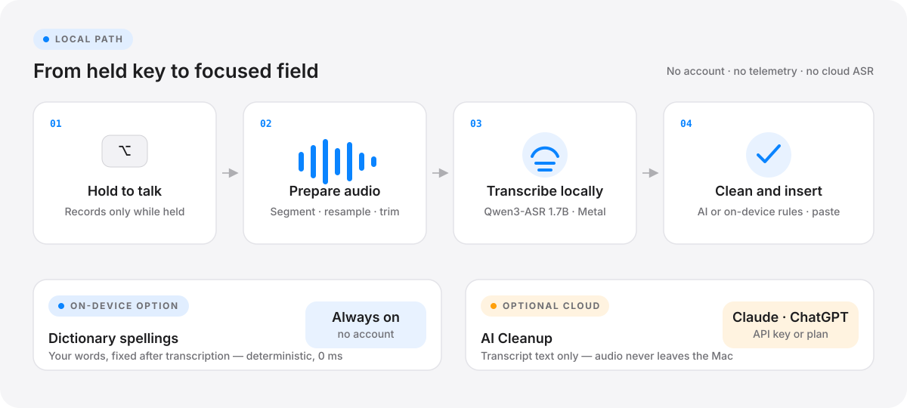
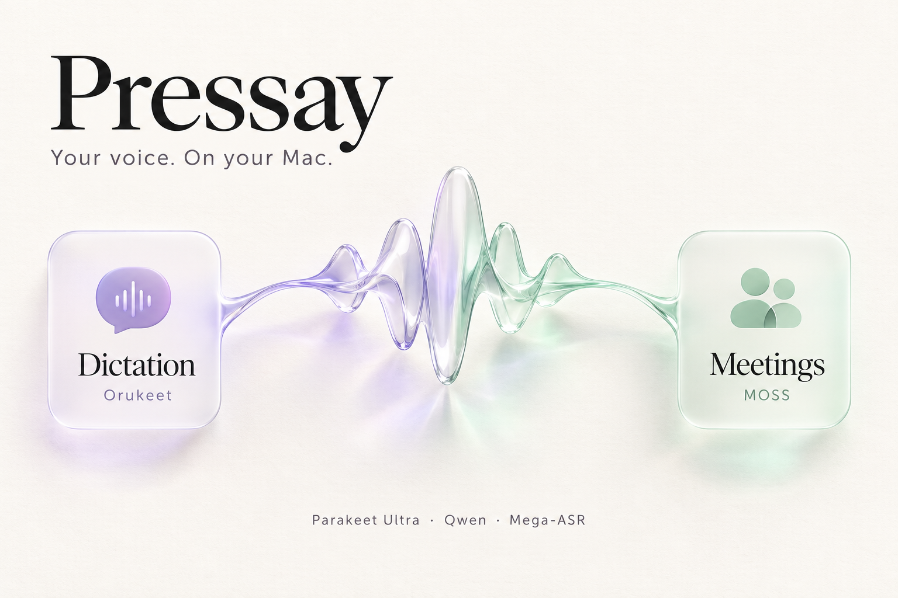
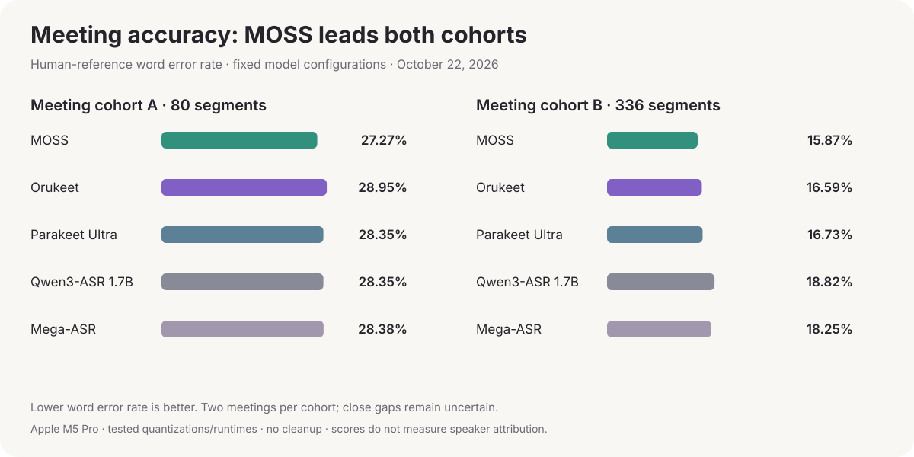
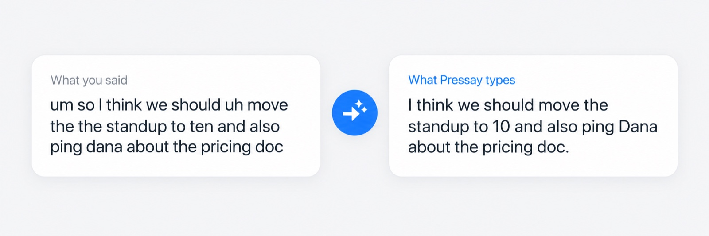
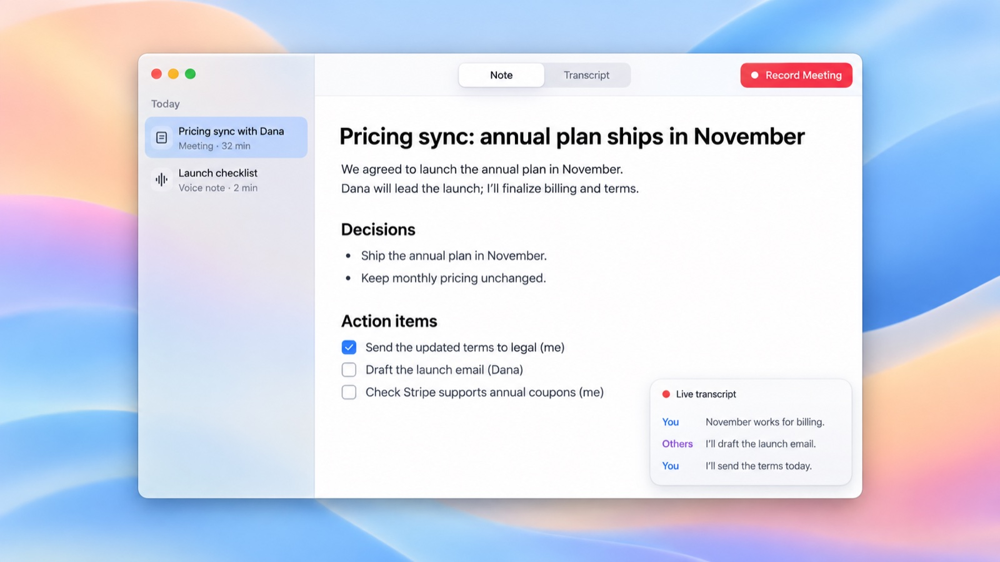

<p align="center">
  
</p>

<h1 align="center">Pressay</h1>

<p align="center">
  <strong>Private, quality-first voice dictation and meeting notes for macOS, Windows and Linux.</strong><br>
  Hold. Speak. Release. Your words appear at the cursor.
</p>

<p align="center">
  <a href="https://github.com/Zheruel/pressay-macos/actions/workflows/ci.yml"></a>
  
  
  
  <a href="LICENSE"></a>
</p>

Pressay is a hold-to-talk dictation app for people who write to coding agents, chats and docs all day. Speech is transcribed on your computer. Optional AI Cleanup, on your Claude or OpenAI subscription or API key, turns the transcript into clean text. Pressay also records meetings: a live on-device transcript of you and the call, then a written-up note.

No account, no telemetry, no subscription. Audio never leaves your computer.

<p align="center">
  
</p>

> [!IMPORTANT]
> Runs on Apple Silicon Macs with macOS 26 or newer, Windows 10/11 x64 and Linux x64. Mac releases use free signing and are not Apple-notarized; Windows installers are not code-signed yet.

## Features

- **Dictation anywhere.** Hold the talk key (Right Option on a Mac, Ctrl+Shift+Space on Windows and Linux; configurable), speak, release. The text lands in the field that was focused when you started, in native, web and Electron apps. The clipboard is preserved.
- **Local speech recognition for each task.** Orukeet is recommended for fast everyday dictation; MOSS for meeting accuracy. Ranked pickers also offer Parakeet Ultra, Qwen3-ASR 1.7B and Mega-ASR, plus four other models. Orukeet and Mega-ASR are Mac-only. All models use automatic language detection; fixed-language choices appear where the runtime supports them.
- **AI Cleanup (optional).** Fixes misheard words, removes fillers and false starts, and formats lists and paragraphs. Uses your Claude or OpenAI subscription or API key. Only text is sent.
- **Notetaker.** Offers to take notes when a call starts. Records your mic as "You" and tells the other people on the call apart on-device (Speaker 1, Speaker 2, or their names), so it works with Zoom, Meet, Teams or Slack and no bot joins the call. When the call ends you get a titled note with a summary, decisions, action items with owners, and open questions. Edit the note in place, Ask anything about one meeting or all of them, and keep your action items in one list.
- **Your own dictionary.** Starts empty. Add names and terms yourself; Pressay never adds words automatically. Both the on-device rules and AI Cleanup use your entries.
- **Microphone lifecycle.** The microphone opens when you hold the talk key and closes when you release or cancel. The start sound plays once real audio arrives.
- **One window.** Title-bar tabs for **Home** (your last dictation, the week's stats and searchable history, ⌘F), **Notetaker** and **Dictionary**. **Settings** (⌘, or the cog) has Dictation, AI Cleanup, Notetaker and General tabs. Dark and light themes.

<p align="center">
  
</p>

On a Mac, the recording pill grows out of the notch. Windows and Linux show a small floating overlay instead.

## How it works

<p align="center">
  
</p>

Without AI Cleanup, a deterministic on-device pipeline applies the dictionary and cleans up common speech artifacts. With AI Cleanup on, the model does that job. Terminals and dictations under ten words skip the AI: on short dictations it almost never changed anything. On a timeout, error or usage limit, Pressay inserts the on-device result.

## Transcription

<p align="center">
  
</p>

**Orukeet for dictation. MOSS for meetings.** Fresh Mac installs use these task-specific defaults; Windows and Linux use MOSS, Parakeet Ultra and the other portable models. Choose from the ranked local models in Settings. Models download on first use, and only the active model stays loaded. No Python installation is needed.

<p align="center">
  
</p>

We tested 27 models and reviewed 74 personal recordings before cleanup. MOSS led both public meeting cohorts; Orukeet was much faster. Personal recordings have no verified human transcripts, so there is no established personal dictation accuracy winner. Wispr transcripts were not ground truth. Exact configurations, the top ten and limitations: [`docs/benchmarks.md`](docs/benchmarks.md).

## AI Cleanup

<p align="center">
  
</p>

Choose **Claude** or **OpenAI**, then **Subscription** or **API key**, under **Settings › AI Cleanup**. Pressay chooses the model and reasoning level.

| Provider | Fixed cleanup model | Subscription connection |
| --- | --- | --- |
| Claude | Haiku 5.5, low reasoning | Your installed Claude Code CLI |
| OpenAI | GPT-6 Luna, medium reasoning, Fast | ChatGPT browser sign-in |
| None | Speech model output with your dictionary spellings | No account required |

Cleanup uses [Hex’s default prompt](https://github.com/anomalyco/hex). The dictionary starts empty and supplies only spellings you add manually. A replay of 20 personal transcripts and six controls favored medium reasoning for Luna; Haiku’s medium setting showed no consistent fidelity benefit. These are text-fidelity checks, not verified speech accuracy. The short prompt can still drop qualifications or alter meaning.

OpenAI prepares its WebSocket during recording and reuses it for cleanup, with HTTP fallback. Claude subscription cleanup prepares a fresh, unmodified Claude Code worker during local transcription. The worker receives text only when cleanup is needed; unused workers are cancelled. There are no dummy inference requests or shared conversation history. If cleanup fails or times out, Pressay keeps the local transcript.

API keys are stored in the system credential store (Keychain on macOS, Credential Manager on Windows, Secret Service on Linux). Subscription usage and API billing are separate.

Earlier cleanup comparisons remain in [`docs/claude-cleanup/`](docs/claude-cleanup/README.md); they do not validate the current prompt.

## Meeting notes

<p align="center">
  
</p>

When Zoom, Teams, Meet, FaceTime, Slack or another call app starts using the microphone, Pressay offers to take notes. You can also click **Start Notetaker** in the menu bar (tray) or on the Notetaker tab.

- While it records, the notch (Mac) or overlay shows a red dot, the timer and the audio level. Hover it to stop.
- Your mic and the call's audio are recorded separately. On a Mac, call audio comes from a Core Audio process tap and the first meeting asks for **System Audio Recording** permission; Windows uses WASAPI loopback and Linux the PulseAudio or PipeWire monitor. Echo cancellation is Mac-only, so use headphones on Windows and Linux.
- An on-device voice activity model finds speech, even from quiet participants, and each utterance is transcribed on the Mac as soon as the speaker pauses.
- Up to four other voices are told apart on the Mac. After the call, the AI names a speaker only when they introduced themselves or were addressed by name, and fixes misheard names and terms using your Dictionary. Rename speakers from the meeting header.
- When the call ends (or you click **Stop**), the AI writes the note. Each meeting has **Summary**, **My notes** and **Transcript** tabs. Edit the summary in place as Markdown; it saves as you type. **Write up again** replaces it with a fresh AI write-up.
- **Ask** (⌘J) answers questions about the open meeting or all of them, with follow-up questions. Answers cite their sources with numbered links to the meetings.
- **Action items** collects your open tasks across meetings. Complete them with the checkbox, export them as calendar tasks, or on a Mac add them to Reminders.
- Choose speech recognition, language, and the notes model under **Settings › Notetaker**. Meeting AI requires an Anthropic API key or a ChatGPT subscription connected in AI Cleanup; Claude Code subscriptions and OpenAI API keys currently support dictation cleanup only.
- Audio is never saved. Only the transcript and your notes go to the AI provider, to write the note or answer a question.

The meeting prompt was tuned over six blind-judged rounds on 12 meetings: [`docs/notes/meetings/`](docs/notes/meetings/README.md).

## Pressay vs. Wispr Flow

| | Pressay | Wispr Flow |
| --- | --- | --- |
| Speech recognition | On your computer | Cloud |
| Audio leaves your computer | Never | Yes |
| Account required | No | Yes |
| Price | Free, MIT. AI Cleanup uses your subscription or API key | Subscription |
| Meeting notes without a bot | Yes, on-device transcript | Yes |
| Works offline | Yes, without AI Cleanup | No |
| Platforms | macOS 26+ (Apple Silicon), Windows 10/11, Linux | macOS, Windows, iOS |

## Privacy

| Data | Where it goes | Retention |
| --- | --- | --- |
| Microphone and call audio | Processed on your computer only | Dictation audio 7 days by default; meeting audio never stored |
| Dictation transcript | On your computer. Sent to your AI provider only if AI Cleanup is on | 30 days by default |
| Meeting transcript and your notes | On your computer. Sent to your AI provider when you stop, to write the note | Until you delete the note |
| Text around the cursor | Read briefly to find the insertion target | Never stored |
| Telemetry | None | — |

The speech model downloads once from Hugging Face. After that, dictation works offline.

## Install

**Mac.** Run this in Terminal to install the latest release. No Xcode or Homebrew is needed:

```bash
curl -fsSL https://raw.githubusercontent.com/Zheruel/pressay-macos/main/scripts/install.sh | bash
```

The installer checks the release checksum and app signature before replacing anything. It installs into `~/Applications`, or updates `/Applications/Pressay.app` if that installation exists. Quit Pressay first; the installer will not interrupt a recording. To choose another writable folder, download and inspect the script, then run it with `PRESSAY_INSTALL_DIR` set to that folder.

You can also download the DMG from the [latest release](https://github.com/Zheruel/pressay-macos/releases/latest). Mac builds are not Apple-notarized: a browser download may need **System Settings › Privacy & Security › Open Anyway** after the first launch attempt.

**Windows and Linux.** Download the Windows installer (`…-windows-x86_64-setup.exe`), AppImage or `.deb` from the [latest release](https://github.com/Zheruel/pressay-macos/releases/latest). Windows installers are not code-signed yet, so SmartScreen may warn before installing. On Linux, Wayland needs the GlobalShortcuts and RemoteDesktop portals, and AI connections need a Secret Service.

On first launch, setup asks for Microphone and, on a Mac, Accessibility (to insert text and detect the talk key), then downloads the speech model and has you try a practice dictation. Meeting recording on a Mac also needs System Audio Recording permission. If insertion or the talk key stops working, remove and re-add Pressay under Accessibility in System Settings, then reopen it.

To update, choose **Check for updates** under **Settings › General › App updates**. Updates are signed and verified before installing, and Pressay won't install one while you're dictating or recording. Checks contact GitHub; no telemetry is sent.

### Coming from Pressay 1.x on a Mac

Pressay 1.x (the earlier Swift app) updates straight to 2.0 through its own updater. The new app keeps the same identity and signing certificate, so macOS permissions carry over. On first launch it imports your dictation history, meeting notes and settings automatically. Your API keys and original dictation audio stay where they are until you choose **Import API keys** or **Import recordings** under **Settings › General**. Setup runs once to check permissions.

The import only reads the old app's data and never changes it. To roll back, reinstall [Pressay 1.14.2](https://github.com/Zheruel/pressay-macos/releases/tag/v1.14.2); it finds its data as you left it. Anything recorded in 2.0 does not carry back.

### Build from source

See the [build instructions](apps/desktop/README.md#build) for each platform's requirements. On a Mac you need Apple Silicon, macOS 26+, Xcode 26+ with the Metal Toolchain, Rust, Node.js 24, Python 3.11+ and CMake, plus at least 8 GB of free space for builds and model caches.

```bash
git clone https://github.com/Zheruel/pressay-macos.git
cd pressay-macos
make test
make install
```

`make app` builds installers into `target/release/bundle` without installing; `make install` (Mac) replaces `/Applications/Pressay.app`; `make run` starts a development build. If Xcode reports a missing Metal Toolchain, install it with `xcodebuild -downloadComponent MetalToolchain`.

Ad-hoc signed builds change the app's identity, so macOS asks for permissions again after each rebuild. For stable permissions on one Mac, run `./scripts/create-local-signing-certificate.sh` once and build with `APPLE_SIGNING_IDENTITY` set to that certificate.

## Dictionary

Add words on the **Dictionary** tab. Click a word to add what it gets misheard as under **Sounds like** (for example, `myRepository` sounds like "my repository"), or to remove it.

The dictionary starts empty and only contains words you add. Pressay does not learn from corrections or scan your history for new entries.

## Development

Pressay is a Rust workspace with a Tauri app:

```text
apps/desktop/          Tauri app: web UI (ui/) and native shell (src-tauri/)
crates/pressay-core/   Dictation, AI providers, notes, vocabulary, storage, migration
crates/pressay-asr/    Speech worker process around the pinned transcribe.cpp runtime
Runtime/               Swift package for the Mac MLX speech worker (Orukeet, Mega-ASR)
```

```bash
make build
make test
```

CI runs formatting, Clippy and the tests on macOS, Windows and Linux for every pull request. Pushing a `vX.Y.Z` tag that matches the app version publishes installers for all three platforms and the signed update feeds; see [release setup](docs/releases.md). The bundle identifier stays `dev.localflow.app`. Model data stays in the app's data folder; executable runtimes ship inside the signed app.

Design and platform notes: [architecture decision](docs/architecture/001-shared-rust-core.md), [validation record](docs/cross-platform-validation.md).

Benchmarks: [ASR](docs/benchmarks.md), [AI Cleanup](docs/claude-cleanup/README.md), [meeting notes](docs/notes/meetings/README.md). Keep audio, transcripts and API keys out of the repository. See [CONTRIBUTING.md](CONTRIBUTING.md).

## Known limitations

- Macs need Apple Silicon and macOS 26+. Orukeet, Mega-ASR, Reminders export and the notch overlay are Mac-only.
- On Wayland, insertion goes through the desktop portal and needs your consent; keep the cursor in the target field until the text appears.
- Windows and Linux meetings have no echo cancellation; use headphones.
- Speaker separation tells apart up to four other voices and works best on meetings under an hour; a line is occasionally given to the wrong person.
- Insertion relies on Accessibility on a Mac; some custom editors behave differently.
- Accuracy varies with microphone, accent and noise. Review text before running destructive agent commands.
- No notarized Mac builds or code-signed Windows installers yet.

## Acknowledgements

- [transcribe.cpp](https://github.com/handy-computer/transcribe.cpp) for the ggml speech runtime.
- [Tauri](https://tauri.app) for the app shell.
- [Qwen3-ASR](https://huggingface.co/Qwen/Qwen3-ASR-1.7B), [Fun-ASR MLT Nano](https://huggingface.co/FunAudioLLM/Fun-ASR-MLT-Nano-2512), [Whisper Large V3 Turbo](https://huggingface.co/openai/whisper-large-v3-turbo) and [Voxtral Mini 3B](https://huggingface.co/mistralai/Voxtral-Mini-3B-2507) for the speech models.

See [THIRD_PARTY_NOTICES.md](THIRD_PARTY_NOTICES.md). Source code is [MIT](LICENSE); model weights keep their own licenses.
