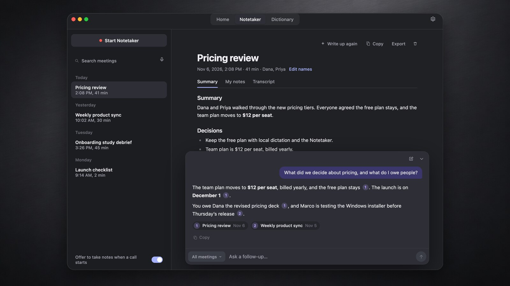

# Pressay desktop app

This is the Pressay app for macOS, Windows and Linux: a Tauri shell over the shared Rust core in [`crates/`](../../crates). It covers local dictation, searchable history with audio playback and corrections, manual vocabulary, optional AI cleanup, voice notes, live meetings, speaker separation, editable notes, action items and Ask. Guided setup checks the microphone, Accessibility and the speech model before you start.



The window has three tabs in its title bar:

- **Home**: your last dictation, the week's stats, and every dictation, searchable with ⌘F.
- **Notetaker**: meetings and voice notes. Edit a note in place; it saves as you type. Ask (⌘J) answers questions about one meeting or all of them and links each point to its meeting.
- **Dictionary**: words Pressay should spell your way.

Settings (⌘, or the cog) holds Dictation, AI Cleanup, Notetaker and General.

The app uses the `dev.localflow.app` identity, so on a Mac it replaces Pressay 1.x (the earlier Swift app) in place. It keeps its own store and credential entries. Platform integrations and release acceptance are tracked in the [architecture decision](../../docs/architecture/001-shared-rust-core.md) and [validation record](../../docs/cross-platform-validation.md).

## Build

Requirements: Rust 1.90+ (CI uses current stable), Node.js 24, Python 3.11+, CMake, and a native C++ toolchain. macOS builds target Apple Silicon/macOS 26 and need Xcode 26 plus the Metal Toolchain for the MLX worker in `Runtime/`. Windows packaging needs Visual Studio Build Tools and WebView2. Linux needs the development packages listed in `.github/workflows/ci.yml`; meeting capture also needs `pulseaudio-utils` and PulseAudio or PipeWire's PulseAudio compatibility service.

From the repository root:

```sh
make test   # cargo test --workspace --locked
make app    # python3 scripts/build-desktop.py
```

Installers land in `target/release/bundle`. The build stages the pinned native runtime, Rust ASR and analysis workers, and the Mac Swift/MLX and meeting-capture helpers. It includes the checksum-verified Sortformer frontend patch needed for long meetings. Model weights are downloaded when their feature/model is prepared, not bundled in the installer.

`make install` (Mac) builds and replaces `/Applications/Pressay.app`. The manual `Desktop preview installers` workflow builds macOS, Windows and Linux artifacts without publishing a release. Tagged releases are built, signed and published by `release.yml`; see [release setup](../../docs/releases.md). A local build has no update feed key and is not trusted-signed.

On macOS, rebuilding with an ad-hoc signature changes the app's identity for permissions. Set `APPLE_SIGNING_IDENTITY` to a stable certificate (for example the local "Pressay Local Signing" identity) to keep Microphone and Accessibility grants across rebuilds. The talk key needs only Accessibility; Pressay no longer asks for Input Monitoring. If System Settings shows Accessibility on but setup still asks for it, choose **Reset Accessibility access**: it clears stale Pressay entries (including the old Preview app) and asks again.

For development on macOS/Linux, `make run` does the following, using the staged workers explicitly so meeting analysis and Mac MLX resources resolve beside the selected ASR worker:

```sh
python3 scripts/build-desktop.py --no-bundle
npm --prefix apps/desktop ci
PRESSAY_RUNTIME_DIR="$PWD/apps/desktop/src-tauri/runtime" \
PRESSAY_WORKER_PATH="$PWD/apps/desktop/src-tauri/binaries/pressay-asr-worker" \
npm --prefix apps/desktop run dev
```

On Windows, set those environment variables in your shell and use `pressay-asr-worker.exe`. Without overrides, debug builds select `target/debug/pressay-asr-worker`. Environment overrides are native development settings, never renderer commands.

## Use and platform differences

- The default talk key is **Right Option** on a Mac and **Ctrl+Shift+Space** on Windows and Linux. **Settings › Dictation** can change it; Mac also supports physical modifier/Fn keys. Setup displays the registered or portal-granted binding. Escape cancels active dictation, and overlays avoid taking text focus.
- Dictation recognizes completed speech in the background after eight seconds and a half-second pause, then processes the remaining tail on release. Original trim rules, begin/release/cancel/error sounds and live level/status overlays are retained. A five-minute capture limit stops and transcribes automatically; it does not discard the recording.
- The catalog retains five recommended models (Orukeet, MOSS, Parakeet Ultra, Qwen3-ASR 1.7B, Mega-ASR) and four Other models (Fun-ASR MLT Nano, Whisper V3 Turbo, Voxtral Mini 3B, Qwen3-ASR 0.6B). Fixed-language choices appear only where supported. Orukeet and the existing Mega-ASR Swift/MLX worker remain Mac-only; Windows/Linux have the seven portable choices. Unavailable imported choices are preserved and require explicit selection.
- Meetings keep microphone and remote tracks separate: CoreAudio process taps on Mac, WASAPI loopback on Windows, and the active PulseAudio/PipeWire monitor on Linux. Capture and optional final speaker separation support up to eight hours. Device/queue failures are reported. Mac voice processing has an explicit fallback; Windows/Linux currently have no echo cancellation in these adapters, so headphones matter.
- Wayland uses GlobalShortcuts and RemoteDesktop keyboard portals with denial, revocation and session-loss handling. Enable **Insert at the current cursor using the desktop portal** to opt in: Wayland does not reveal the original target application. Keep the intended cursor focused until insertion finishes. Unsupported portals or rejected text leave the transcript available for manual copy. X11 uses its native focus/insertion path; Wayland never silently falls back to X11 automation.
- Optional Claude/OpenAI API connections keep keys in the OS credential store. ChatGPT browser sign-in and Claude subscription access through the official Claude Code tool are implemented. AI sends text to the chosen provider; recognition remains local. Linux requires an available Secret Service for credential storage.
- Notes support write-ups, in-place Markdown editing, transcript review, named speakers, action-item checkboxes, Markdown export, calendar-task export and Ask with cited meetings. Ask across all meetings picks the meetings that match the question's words, people and dates ("last week", "on Monday"), up to 25. macOS additionally supports native Reminders export. Call suggestions use native capture-stream heuristics, not guaranteed identification of every call. A meeting bound to a detected call stops when that call ends, including when suggestions are disabled. A two-minute warning precedes the duration limit. Quitting drains the transcript tail and defers optional write-up work; startup resumes eligible pending write-ups when AI and a provider are available.
- Launch at login, retention and in-app updates (**Settings › General › App updates**) are implemented. Dictations are kept for 30 days and their audio for seven; corrected entries (and any pinned in earlier versions) are kept. **Settings › General › Clear history** asks first, then removes every entry, including corrected ones, and their audio. Failed-recognition diagnostic audio expires after seven days. Silent completed recordings without personal notes and explicitly discarded recordings are removed; interrupted recordings retain saved transcript segments. Updates are signature-checked and won't install while a dictation, recording or model preparation is running.

Physical-device, compositor, editor/IME and permission testing remains necessary across supported systems. [Meeting validation](../../docs/portable-meeting-validation.md) records the actual worker checks and memory bounds; it does not claim complete hardware QA.

## Migration and rollback

On a Mac, Pressay 1.x updates to this app through its Sparkle feed (see [releases](../../docs/releases.md#updating-pressay-1x-swift-app)). On first launch the app imports the 1.x dictation history (`~/Library/Application Support/Pressay/History.store`), meeting notes (`Notes.json`) and settings from its preferences, once. The import reads those files without changing them and skips records it already has.

API keys and original dictation audio stay explicit: choose **Import API keys** or **Import recordings** under **Settings › General**. Neither deletes or rewrites the original data. Audio import accepts recordings up to five minutes; longer originals remain untouched. Microphones are saved by stable device ID. Imported Mac UIDs resolve to the exact device; unavailable IDs or ambiguous old device names require an explicit choice. **Import a copy** and **Export…** in the same section move a JSON backup of settings, dictations and notes between machines; it contains no credentials or audio.

Meeting analysis uses private temporary system-audio files, removed on completion/cancel and recovered by locked orphan cleanup after a crash; see the validation notes for details.

Rollback is reinstalling Pressay 1.14.2, whose data is unchanged. Records made in this app are not copied back.
