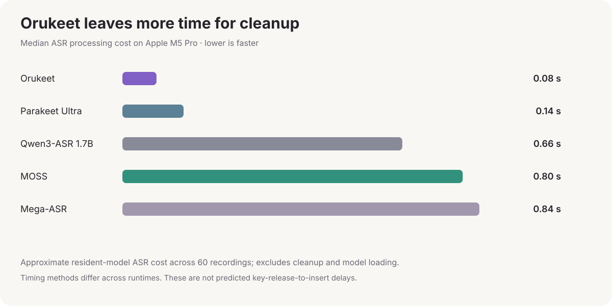

# Local transcription benchmarks

**October 22, 2026 · Apple M5 Pro · 24 GB · macOS 27.0.1.** We tested 27 base models, 74 personal recordings and two public meeting cohorts. Scores below describe the exact runtime and quantization tested, not every implementation of a model.

## Recommended setup

Fresh installs use **Orukeet for dictation** and **MOSS for meetings**. The pickers rank the five recommended choices for each task. Existing explicit dictation selections are preserved, including legacy models for additional languages. Only the active engine remains resident; changing tasks unloads the previous worker before loading another model.

MOSS made 4–6% fewer word errors than Orukeet across the two meeting cohorts: about 7–17 fewer errors per 1,000 reference words. Orukeet is much faster and performed well in personal transcript reviews. Those recordings have no verified human transcripts, so this does **not** establish a personal dictation accuracy winner. The dictation order weighs useful output and responsiveness; it is not an accuracy leaderboard.

## Top ten recommendations

This is a curated recommendation order that considers lexical quality, meaningful errors, robustness and processing cost. Close gaps are uncertain. The app offers the first five models; the remaining five are research comparisons.

| Model | Clean read speech WER | Meeting A WER | Meeting B WER | Approx. ASR cost |
| --- | ---: | ---: | ---: | ---: |
| MOSS · Metal Q6_K | 6.67% | **27.27%** | **15.87%** | 0.80 s |
| Orukeet v0.1 · optimized Metal Q8 | 5.99% | 28.95% | 16.60% | **0.08 s** |
| Parakeet Ultra · Metal Q8 | 5.77% | 28.35% | 16.73% | 0.14 s |
| Qwen3-ASR 1.7B · Metal Q6_K | 4.75% | 28.35% | 18.82% | 0.66 s |
| Mega-ASR · MLX BF16 | 4.81% | 28.38% | 18.25% | 0.84 s |
| MiMo V2.5 ASR · corrected MLX 8-bit | **3.11%** | 31.69% | — | 2.15 s |
| Qwen3-ASR 0.6B · Metal Q8 | 5.26% | 29.14% | — | 0.37 s |
| GLM-ASR Nano · MLX 8-bit | 5.43% | 29.92% | 18.23% | 0.50 s |
| Canary-Qwen 2.5B · Metal Q8 | 4.75% | 31.41% | — | 0.46 s |
| Granite Speech 5.0 2B · MLX BF16 | 5.03% | 31.06% | 20.63% | 0.88 s |

Meeting A contains 80 segments; B contains 336. A dash means that additional cohort was not tested. Unequal cohorts are never pooled to rank models. MiMo wins clean read speech but does not lead on conversations. Whisper Large V3 scored 35.26% / 22.04% on the two meeting cohorts and did not enter the top ten.

The table’s Mega-ASR figures use the original Python MLX runtime. The release’s native Swift port was separately replayed on all 160 public clips plus 12 personal parts: **28.13% meeting-A WER and 4.75% FLEURS WER**, versus 28.38% and 4.81% originally. All 172 calls completed without truncation; peak MLX allocation was about 5.08 GiB. Its learned quality router, including all adapter aliases, is retained. Text differs on some clips; this small public difference does not establish a better model.

## Method and limits

- **Clean read speech:** 80 English-US [FLEURS](https://huggingface.co/datasets/google/fleurs) test clips, 1,769 normalized reference words.
- **Meeting A:** 80 fixed 12-second windows from AMI EN2002a and IS1009a, 3,168 words. Mixed-headset audio; 74 windows straddle word boundaries. Overlapping speakers and chronological reference serialization complicate alignment.
- **Meeting B:** 336 production-Silero-VAD segments from AMI ES2004a and TS3003a, 5,086 words; available for 13 of the 27 base models. [AMI corpus](https://groups.inf.ed.ac.uk/ami/corpus/).
- **Personal recordings:** 60 original and 14 fresh recordings, split into 95 parts of at most about 25 seconds. Wispr audio was an input source; **Wispr transcripts were not ground truth**. Three blinded review passes and direct raw-text inspection assessed plausibility, not spoken accuracy. No acoustic accuracy claim is made from those reviews.
- **WER:** corpus-word-weighted substitutions + deletions + insertions divided by reference words, after symmetric Whisper English normalization and filler removal. Punctuation, case and number formatting are not counted as errors. WER does not measure speaker attribution.
- **Coverage:** every base model has attempts for all 160 common public clips and all 95 personal parts, with required repetitions. Attempt coverage does not mean every run succeeded. Twelve selected flagged outputs, including truncation and repetition, remain disclosed in the private audit; empty output is not automatically an error.
- **Sensitivity:** fixed interior-word masks and an all-insertion guardrail left MOSS first on pooled Meeting A under all six secondary variants. Other close orders changed. These checks cannot repair clipped audio or establish general superiority from two correlated meetings per cohort.

Only sanitized aggregates are committed in [the results file](benchmarks/local-asr-2026-10-22.json). Private audio, transcripts, per-clip outputs and audit artifacts remain excluded from Git. The older [results.json](benchmarks/results.json) is historical and uses a different methodology; it does not establish the current ranking.

## Speed and runtime

Timings are approximate median resident-model processing costs across the original 60 recordings. Native batch timings are single-pass because that CLI ignored its repeat flag; MLX used a second pass. Input/synchronization accounting differs. They exclude model loading, download, AI cleanup and insertion, and are not calibrated end-to-end latency predictions.

Pressay keeps one worker process resident. Bundled, signed native code runs Orukeet through its optimized Metal runtime and MOSS/Parakeet/Qwen through a pinned transcribe.cpp build. Mega-ASR runs through Swift MLX. Users do not need Python or command-line tooling. Audio crosses an anonymous local pipe and is never uploaded; meeting PCM is not written to disk by the worker.

The previous installed configuration measured roughly 0.42 s ASR, 1.2 s cleanup and 1.9 s total median in recent app history. Faster ASR does not remove the cleanup delay. Kernel/thread experiments and a small SGLang comparison did not justify a further switch. A speculative decoding prototype changed outputs and was excluded from the release.

## Release verification

The packaged Orukeet, MOSS, Parakeet Ultra and Qwen paths were replayed on **39 held-out audio parts each, twice** through `PressayBench` and the production worker client. All repeats matched. MOSS, Parakeet and Qwen matched all 39 earlier audit outputs; Orukeet matched 38 and differed on one unverified proper-name spelling. Three engines returned empty on the same two private parts; the client reports `emptyTranscript` rather than silently inserting text. This is a regression check, not a new personal accuracy score.

Six worker lifecycle tests cover reuse/replacement, errors/restart, cancellation, timeout, broken pipes and partial-output flags. The release bundle is built and checked with `codesign --verify --deep --strict`. The installed app’s ranked pickers, Orukeet→MOSS→Orukeet replacement, and a brief microphone-only meeting start/stop were checked interactively. The empty test meeting was removed automatically; AI notes and system audio were disabled for the test and restored afterward. Full live system-audio calls and cross-app dictation insertion were not replayed; audio-file tests do not establish those behaviors.

## Cleanup and vocabulary

The cleanup prompt now makes faithfulness outrank grammar: retain short directives, modal alternatives, actors, negation and full conditional scope. An audit of 100 saved raw→clean pairs found one clear omitted directive and three possible meaning changes. Historical pairs do not store model or prompt versions, so they cannot identify a current-model error rate.

The dictionary remains a spelling aid after transcription. **It is not injected wholesale into ASR.** MOSS with the existing 67-term glossary worsened read-speech WER from 6.67% to 15.94% and meeting-A WER from 27.27% to 27.59%. Custom dictionaries are preserved. Model names in the AI prompt are contextual spelling guidance; ordinary words such as “moss” must not become model names.

Benchmark plots are generated deterministically by `python3 scripts/render-asr-charts.py`. The opening conceptual artwork was generated with GPT Image; it contains no measured scores and is not an app screenshot.
