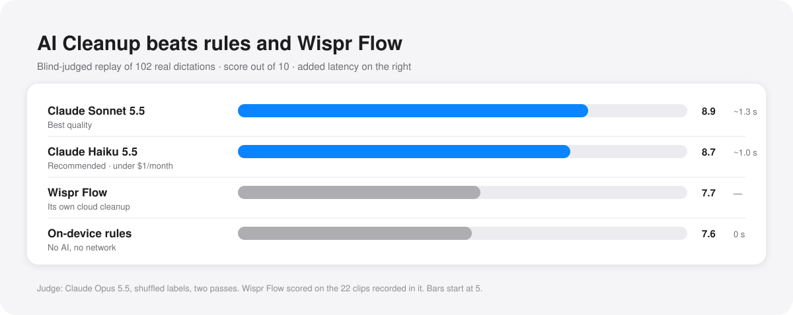

# Claude cleanup benchmark — October 2026

Can a Claude model replace the rules-only cleanup step (DeterministicPromptCleaner + TranscriptStructurer)?

## Verdict

Yes. Pressay ships **Haiku 5.5, effort `medium`, with `prompt.txt`** as the default: +1.2 points over the rules-only output on a 0–10 judged scale, ~1.0 s median added latency, under $1/month at 100 dictations/day with prompt caching.

**Sonnet 5.5, effort `low`, thinking off** is offered for the best quality: +0.2 over Haiku (+0.39 on held-out clips), ~0.3 s slower, ~$5/month.

On a ChatGPT plan, **GPT-6.1 Sol at effort `low`** is the default (see below).

Keep **Qwen3-ASR 1.7B** as the speech model. Claude cannot recover words the ASR got wrong, so smaller ASR models lose quality even after cleanup.

  

## Setup

- Corpus: 104 real dictations (22 min). 24 recorded in Wispr Flow (with Wispr's cleaned output as a reference candidate), 80 recent Pressay dictations. 102 contain speech.
- Input: raw Qwen3-ASR 1.7B transcript + the user's vocabulary list (with "often misheard as" aliases) + target app.
- Judge: Opus 5.5 (high effort), blind and shuffled. It scored all candidates per clip on fidelity, readability and overall, and flagged meaning changes. It cannot hear audio, so it infers truth from four independent ASR transcripts (plus Wispr's). Each round ran two independently shuffled passes; agreement between passes was r = 0.93–0.95.
- Latency: sequential streaming requests from this Mac.

## Results

Round 1, prompt × model × effort (overall / meaning changed %):

| | light | concise |
|---|---|---|
| Haiku 5.5 low | 8.30 / 4.4% | 8.47 / 12.7% |
| Haiku 5.5 medium | 8.21 / 3.9% | 8.64 / 8.3% |
| Sonnet 5.5 low | 8.49 / 2.9% | 8.45 / 19.1% |
| Sonnet 5.5 medium | 8.50 / 3.4% | 8.50 / 17.2% |
| Rules only (today) | 7.47 / 5.4% | |
| Apple on-device LLM | 7.47 / 6.4% | |
| Wispr Flow output (22 clips) | 7.48 / 6.8% | |

The concise prompt reads best but drops hedges ("I think", "feel free") and invents terms. The light prompt is faithful but near-verbatim. The `balanced` and `balanced2` prompts (the shipped `prompt.txt`) get both.

Final round:

| Setup | Overall | Fidelity | Readability | Meaning changed |
|---|---:|---:|---:|---:|
| **Sonnet 5.5 low + balanced2** | **8.83** | 9.24 | 8.94 | 4.4% |
| Sonnet 5.5 low + balanced | 8.79 | 9.33 | 8.85 | 3.9% |
| **Haiku 5.5 medium + balanced2** (default) | 8.68 | 9.28 | 8.65 | 4.4% |
| Haiku 5.5 low + balanced2 | 8.63 | 9.12 | 8.75 | 6.9% |
| Rules only (today) | 7.53 | 8.82 | 7.40 | 5.4% |

("Meaning changed" for rules-only is ASR errors left unfixed. Claude's rate is lower because it repairs more than it breaks.)

- Effort: low vs medium made no difference for either model (paired CIs straddle 0). For Sonnet, use low with thinking off; for Haiku, medium cut meaning changes slightly.
- Sonnet vs Haiku (balanced2): +0.20, 95% CI [+0.02, +0.38].

ASR swap, all cleaned with Sonnet + balanced2:

| ASR | Overall | ASR median (long clips) |
|---|---:|---:|
| **Qwen3-ASR 1.7B** | **8.84** | 0.39 s (0.87 s) |
| Whisper V3 Turbo | 8.70 | 0.67 s (0.86 s) |
| Qwen3-ASR 0.6B | 8.37 | 0.22 s (0.54 s) |
| Fun-ASR MLT Nano | 8.32 | 0.30 s (0.70 s) |

## Follow-ups: Haiku effort, a Haiku-tuned prompt, held-out check

- **Haiku effort** (balanced2, with Wispr Flow's own cleanup as a candidate): Sonnet low 8.94; Haiku medium 8.75, high 8.73, xhigh 8.69; rules 7.69; Wispr Flow 7.67 (22 clips). High and xhigh bought nothing and add thinking latency (xhigh p90 4.4 s). Sonnet vs Wispr Flow: +1.15, 95% CI [+0.51, +1.81].
- **Haiku-tuned prompt** (`balanced3`: more examples for fragments, spoken enumeration and phonetic names): on the 102 tuning clips it cut the gap to Sonnet from 0.20 to 0.09 (n.s.).
- **Held-out check**: 60 unseen dictations from earlier history, never used for prompt work. Sonnet + balanced2 8.68, Haiku medium + balanced2 8.34, Haiku + balanced3 8.29. Gap +0.39, 95% CI [+0.16, +0.65]. The balanced3 gain did not generalize, so balanced2 ships.
- **How noticeable:** on both sets Sonnet is clearly better (≥1 point) on ~1 in 6 dictations and Haiku on ~1 in 15; the rest are within a point. Haiku's typical miss is a misheard name left in place (Retell, Open-Meteo).

## Does the dictionary earn its place?

Haiku-judged, 102 clips, Haiku medium + balanced2, varying only the vocabulary block (`VOCAB=full|terms|none` in `gen.py`):

| Vocabulary block | Score |
|---|---:|
| Terms + "often misheard as" aliases | 7.96 |
| Terms only | 7.94 |
| None | 7.61 |

The terms are worth +0.35 and the aliases add nothing measurable (+0.02, n.s.). Verdict: keep the dictionary as a plain word list and make aliases optional. They still help the rules-only path when Claude is off. The Kimi review stage of the tuner was cut.

Engine: transcribe.cpp stays on v0.1.3. A newer build with vocabulary biasing was slower in interleaved runs (1.51/1.63/1.68 s vs 1.40/1.58/1.58 s per round).

## ChatGPT plan models

Same 102 clips and prompt, judged blind by Haiku 5.5 over 2 passes. Scores are only comparable within this table.

| Model | Overall | Median latency |
|---|---:|---:|
| **GPT-6.1 Sol, effort low** (ChatGPT default) | **7.96** | ~3.3 s |
| Sonnet 5.5 low | 7.85 | 1.3 s |
| Haiku 5.5 medium | 7.67 | 1.0 s |
| GPT-6 Luna, effort medium | 7.42 | 2.5 s |
| GPT-6 Luna, effort low | 7.15 | 2.5 s |
| GPT-6 Luna, effort high | 7.37 | p90 6.6 s |

Luna at medium beats low by +0.27 (95% CI +0.05 to +0.50) at no extra latency, so Pressay runs Luna at medium. High bought nothing.

## Latency and cost

| Model | First token | Total, median | Total, ≥60 words |
|---|---:|---:|---:|
| Haiku 5.5 | 0.65 s | 1.0 s | 1.2 s |
| Sonnet 5.5 | 0.71 s | 1.3 s | 1.6 s |

Average request is ~2.2k input tokens (2.1k of it is the cacheable instruction block plus vocabulary) and ~65 output tokens. With `cache_control` on the system prompt, cache hits were confirmed on both models. That works out to Sonnet ≈ $0.0016 and Haiku ≈ $0.0001 per dictation.

## Implementation notes

- Send the system prompt (with vocabulary) with `cache_control`, and keep it byte-stable so it caches. Put app and transcript in the user turn.
- Skip the API for very short text (≤3 words) and in terminals, or keep the terminal rule in the prompt.
- On timeout or error (e.g. a ~3 s budget), fall back to rules-only output.
- Opt-in: enabled only when a Claude API key is in the keychain or a ChatGPT plan is signed in.

Files: `prompt.txt` (system prompt; `{vocab}` = one term per line, `Term (often misheard as: a, b)`), `gen.py`, `judge.py`, `agg.py`, `paired.py`.
