# Cross-platform migration validation

Recorded 2026-11-06 for the isolated preview and native Mac onboarding changes. The feature surface now includes notes, AI/account integration, live meetings, speaker analysis, Wayland portals and the existing Mac Mega-ASR worker. This record distinguishes implemented code, component evidence and physical acceptance that remains open; it is not a claim that issue #31 has completed all release QA.

## Automated and integration checks

- Native Mac onboarding/migration baseline: 166 Swift tests passed (132 XCTest, 19 core Testing tests, 15 onboarding/settings/migration tests). This count records that run, not a fixed total for subsequent revisions.
- Rust tests cover model download integrity, worker reuse/cancellation/reaping, malformed replies, truncation recovery, migration/retention, credential and provider protocols, notes/action items, queue saturation, stale input events, audio resampling, deadline clipping, VAD timing and shutdown. Exact current workspace totals belong to the PR's CI run.
- An Ubuntu 24.04 ARM64 integration snapshot passed 129 workspace tests and strict Clippy, plus the separately enabled Xvfb insertion test (130 total). Later parity additions are outside that snapshot; it does not validate the final source revision. The CI matrix also targets macOS and Windows.
- Focused meeting checks pass for partial/aligned VAD flush, route-gap origins, hysteresis/frame order, 12-second utterances, exact lead/tail timing, first-appearance voice numbering and majority overlap. Capture tests include real helper-process stop/drain/drop and final-duration clipping accepted by the bounded audio spool.
- Analysis lifecycle tests kill and reap a cancelled or malformed worker. Spool tests verify owner-only files, sparse timeline gaps, duration bounds, deletion and locked orphan cleanup that preserves active files and unrelated paths.
- A later Mac run passed 57 desktop tests and 77 core unit tests plus core integration suites. Added coverage includes current/stale call binding, two-minute warning timing, silent/discarded note handling, pending-write-up eligibility/idempotence, deletion beyond the UI's 10,000-row history limit, and seven-day orphan-audio cleanup preserving referenced files and links. Later changes still require their own CI run.
- JavaScript syntax checks pass. Axe reported zero WCAG 2A/2AA/2.1AA violations on Home, notes, Dictionary, General and onboarding using the real UI JavaScript with mocked IPC. This does not test a screen reader or native WebView accessibility end to end.

Migration tests export 501 original records without retention deleting any, compare History.store/WAL/SHM and notes byte-for-byte, preserve unknown models and legacy vocabulary, exclude credentials, require mode-0600 output, and prevent overwriting source data through direct paths or symlinks. No real user history was exported for these tests.

## Recognition preservation

A public FLEURS replay compared the Rust worker with the original Swift worker using the same pinned Orukeet and MOSS artifacts: six clips in English, French, German, Spanish, Japanese and Chinese, plus an English → one-second silence → French composition. **All 14 paired outputs matched exactly across 28 runs.** The sanitized [replay artifact](benchmarks/cross-platform-worker-replay.json) includes human references, source IDs, PCM hashes, model checksums and individual results.

Source audio and references are from [Google FLEURS](https://huggingface.co/datasets/google/fleurs), licensed CC BY 4.0; attribution and conversion details accompany the artifact. These are public fixtures, not private recordings. Equality demonstrates preservation for this sample, not general accuracy: Orukeet's Japanese/Chinese output remained poor in both hosts, while MOSS produced the corresponding scripts. No new language support is inferred from a shared wrapper.

Earlier public JFK smoke tests also exercised real native decoding with JSON-only protocol stdout:

| Environment | Observation |
| --- | --- |
| macOS Orukeet | 0.159 s reported decode |
| macOS MOSS | Consecutive requests around 0.476–0.486 s; packaged Metal smoke 0.458 s |
| Ubuntu ARM64 CPU MOSS, 6 GB container | 10.60 s and 10.91 s requests; startup/warmup/two requests together 30.88 s |

Those observations use different hardware/backends. They are not framework comparisons or benchmark-quality end-to-end latency measurements. They exclude microphone opening, editor visibility and sustained power/thermal behavior.

## Background dictation replay

A disposable harness ran the production streaming session with real native Orukeet/MOSS workers and Silero, feeding irregular 4,093-sample packets from public FLEURS English/French clips. An English → one-second silence → French fixture with uniform 4× gain (no clipping) and 100 ms of final silence lasted 20.12 seconds. The first cut was at 9.024 seconds; the final 384-sample VAD remainder was retained. The first real ASR reply arrived before the sender closed, one ASR process per model handled all requests, and the workers were reaped.

Orukeet's streamed and whole-clip outputs matched on 39 normalized words, with punctuation differences. MOSS streaming retained 39 words versus 38 whole-clip words, adding the French “et” omitted by whole-clip decoding. The unamplified fixture exposed inherited behavior: every French frame was below the existing RMS 0.003 trim threshold, so whole-clip trimming removed that quiet tail. Preserving Swift's trimming rule does not establish reliable recognition of very quiet speech.

Observed native whole/tail inference was 122.3/48.4 ms for Orukeet and 645.5/385.9 ms for MOSS. Accelerated packet-feed release-to-result was 389/717 ms, including queue catch-up; these are not real-time microphone or visible-insertion benchmarks. Audio provenance is Google FLEURS `en_us` row 1904 and `fr_fr` row 1987, using the pinned models recorded in the [public replay artifact](benchmarks/cross-platform-worker-replay.json). No private audio, microphone or credentials were used. The harness also caught a stale release binary that rejected the language field; rebuilding the ASR/analysis workers resolved it.

The nine-model catalog and language-selection contracts have automated coverage. This replay exercises Orukeet and MOSS only; it does not establish fresh inference validation for every restored Other model. The five-minute capture bound has a crossing-tail test and automatically stops/transcribes instead of dropping the recording. Imported audio is subject to the same bound.

## Speaker analysis and memory

The real Silero worker classified 234/344 JFK frames as speech. Streaming with 777-sample chunks exactly matched 160,000-sample chunks, and independent silent-track state stayed below 0.1 speech probability. The checked-in Sortformer frontend patch matched the original on 15,096,960 mel values with zero difference and retained identical IDs/timestamps on the public two-speaker fixture.

A three-hour silent recording completed analysis in 37.20 seconds at 819,488 KiB peak RSS; eight hours completed in 99.95 seconds at 1,919,632 KiB. These Apple Silicon/Metal measurements include evictable file-backed PCM pages, so they are not constant-memory or real-meeting accuracy claims. The original whole-clip frontend exceeded 3.4 GiB almost immediately in the three-hour test and was stopped. Detailed provenance, bounds and reproduction commands are in [portable meeting validation](portable-meeting-validation.md).

## Native integration evidence

| Area | What was exercised | What it does not establish |
| --- | --- | --- |
| Linux X11 | Xvfb + real libxdo generated key events; clipboard selection ownership stayed unchanged; WM_CLASS target identification and focus-change refusal passed | Real application/IME behavior, every clipboard format or physical desktop acceptance |
| Linux portals | Private `dbus-daemon` with a mock portal exercised production wire serialization, early responses, hold/release, Unicode key press/release, control-text refusal and revocation with no further insertion | Actual GNOME/KDE consent, compositor policies, layouts or real Wayland editor insertion |
| Mac MLX resources | A relocated app probe linked the exact Cmlx object used by the Swift worker and completed a real Metal 1,024-element vector addition; removing its adjacent resource bundle caused the expected failure, restoring it passed | Mega-ASR model loading, transcription accuracy or full model inference |
| Mac input/overlay | Real Preview Microphone, Input Monitoring and Accessibility grants recognized in onboarding; native code checks, synthetic CGEvent objects without posting input, and AppKit structure checks for nonactivating/click-through overlay and interactive guide | Physical hold/release, lock behavior or insertion into an editor are separate acceptance checks |
| Windows native adapters | Cross-target API checks cover capture/platform/session integration | A Windows runtime, real WASAPI devices, UAC/editor behavior or clean-machine acceptance |

Native capture includes Mac CoreAudio taps, Windows WASAPI loopback and Linux PulseAudio/PipeWire monitor processes. Their implementation and fixture tests do not establish actual device routing, Bluetooth behavior or echo quality. Mac has voice-processing fallback; Windows/Linux adapters currently lack echo cancellation. Linux alignment uses monotonic/sample-count timing rather than validated shared hardware clocks.

Useful Linux integration commands:

```sh
cargo test -p pressay-desktop --locked wayland
xvfb-run -a cargo test -p pressay-desktop --locked x11_insertion -- --ignored --nocapture
```

First-run integration checks caught and fixed missing updater configuration and synchronous microphone enumeration. Native enumeration now reads CoreAudio metadata without opening an audio unit. With explicit user approval, the packaged Preview received Microphone, Input Monitoring and Accessibility access. All three grants were recognized by onboarding after removing/re-adding obsolete ad-hoc Accessibility and Input Monitoring entries and reopening Preview; tightly scoped TCC logs confirmed a code-requirement mismatch. The original app’s permission entries were left intact. The Preview used an isolated disposable profile and no account credentials. The rebuilt app loaded the verified cached Orukeet model and reached practice with all three permissions recognized. A separate `Control+Shift+Space` shortcut was seeded in the disposable profile while Preview was stopped to avoid activating the original app; this does not validate the physical shortcut recorder. AppleScript/System Events provided UI inspection after the native control service failed. The user then reported that live dictation appeared to work. The disposable profile contained two real Orukeet dictations (approximately 1.3 and 2.9 seconds). This confirms capture and recognition, with user-reported insertion; it does not establish completed onboarding, which remained incomplete in that profile. Preview was stopped and its original profile restored. No transcript text or private audio is included here.

The visual reference is the **existing native Pressay app**. The shared shell uses its six destinations, window/sidebar measurements, colors, typography, grouped controls, Home metrics, Dictionary autosave, History app icons/search, General tabs, full-page notes and Ask capsule. Model selection prepares immediately. Setup opens in its own 540×720 window with welcome, three permission screens, model preparation and real practice; it accepts only a fresh dictation that began and inserted in this app with exactly matching practice text. macOS uses the original SwiftUI notch-island geometry, with a corresponding portable island and hover Stop control. The tray uses the original 348-pixel panel on macOS/Windows; Linux uses a native menu because its tray API does not provide click coordinates.

The final local Rust workspace run passed 184 tests, and strict workspace Clippy passed. Actual frontend code against synthetic IPC passed twelve WebKit screen/theme accessibility scans, all six setup steps, thirteen settings/History scenario groups plus the final review regressions, notes editing/transcripts/actions, tray actions, and delayed credential-save recovery. Navigation cancels shortcut capture, including navigation from the tray; failed shortcut/Dictionary saves keep drafts. Setup tests reject typed, stale, other-app and prefixed-text completion and cover closing while capture activation is pending. These tests do not replace physical Windows/Wayland or screen-reader acceptance.

A defect-first review covered the complete migration diff and a second review inspected its fixes. Temporary regressions reproduced blocked practice completion, correction draft loss, stale model selection, delayed Ask replies in a changed scope and first-open Ask keyboard focus. The ownership check now runs before insertion releases its token, target lifetimes allow a five-minute recording plus processing, and Ask retains the native floating panel, scope switch, suggestions and new-chat behavior. Remaining fixes preserve stable microphone identities, valid calendar task timestamps, main-window geometry and recovery after a failed installer. Windows preview installers bundle the VC runtime. Cleanup removed the unused scheduler prototype, redundant routing/count/fixture assertions and dead overlay review hooks; process, permission and data-integrity regressions remain.

Microphone selection uses CPAL stable IDs, retaining duplicate display names and refusing unavailable or ambiguous legacy choices. Real CoreAudio metadata matched every CPAL device ID without opening audio. Linux and Windows meetings share CPAL microphone capture, while Linux system audio remains on the Pulse/PipeWire sink monitor. A real Ubuntu 24.04 PulseAudio null-sink session confirmed the CLI metadata schema; this is not physical recording evidence. Native window tests preserved a resized 1000×700 frame and position over two relaunches, kept a background launch hidden, and retained fixed 540×720 setup geometry. A temporary filesystem harness exercised the production one-shot update failure notice; no live updater installation was attempted.

Native island fixtures rendered sixteen phase/notch/hover states and exercised nonactivation, click-through and cleanup. The portable island fixture exercised five bars, elapsed time, hover Stop, finishing/success/error and reduced motion. A relocated Cargo-linked binary ran with system Swift runtime libraries and no `DYLD_*` override. On Windows/Wayland, pointer queries and overlay positioning remain compositor-dependent and require physical acceptance.

## Packaging and visual inspection

Native Swift app builds and nested-signature verification passed. The native DMG validation checks its Applications symlink, Finder geometry, 1×/2× background and nested signature. The final desktop build produced a sealed Mac app and branded DMG. Strict deep signature checks, the app resource seal, all 38 bundled Mach-O deployment versions, the DMG checksum and mounted Finder-layout checks passed. Constructing an installer is not proof of consent or upgrade acceptance.

An earlier packaged preview launched, exposed its initial accessibility tree and prepared Orukeet from verified cached weights. The native welcome/microphone guide was inspected through a separate debug fixture; simulated fixture status is not an OS permission grant. Real UI JavaScript has also been inspected with mock data in dark/light and narrower layouts.

A relocated packaged Mac app launched through Launch Services with a disposable synthetic profile. The separate setup window rendered the welcome and permission screens; closing it restored the main window. The tray opened from another foreground app, stayed within the display, and reopened setup through its real command. The original Preview profile was restored after quitting the fixture. Directly executing the relocated binary outside Launch Services failed path resolution; normal app launch passed.

The comparisons below use matching synthetic content in the native Swift app and shared WebKit UI. Native traffic lights/window corners are supplied by macOS; browser fixtures omit them. Dates and readiness reflect each fixture's state, and text rasterization can differ. The packaged welcome image is the real Tauri window. The native reference's extra bottom title-bar strip is not reproduced.

| Screen | Native Pressay reference | Shared desktop |
| --- | --- | --- |
| Home | 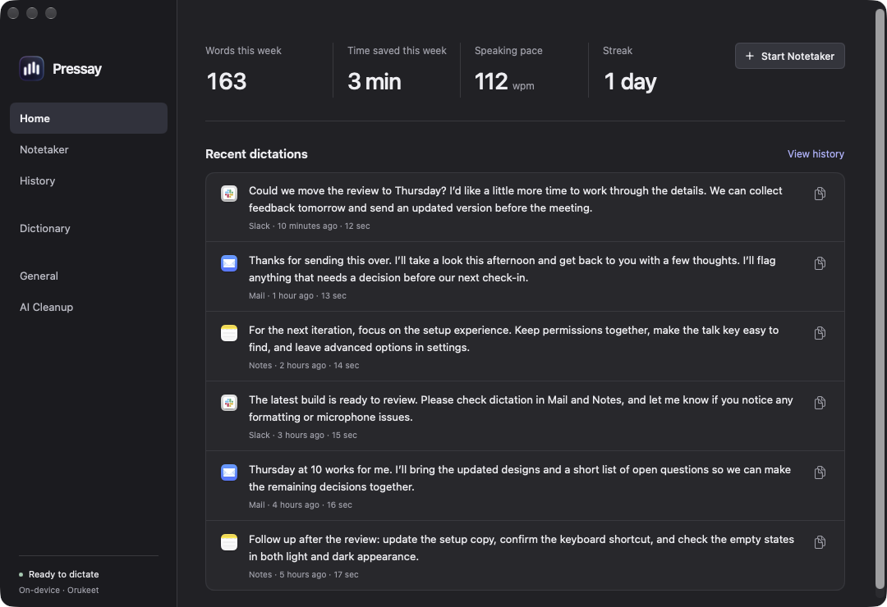 |  |
| General | 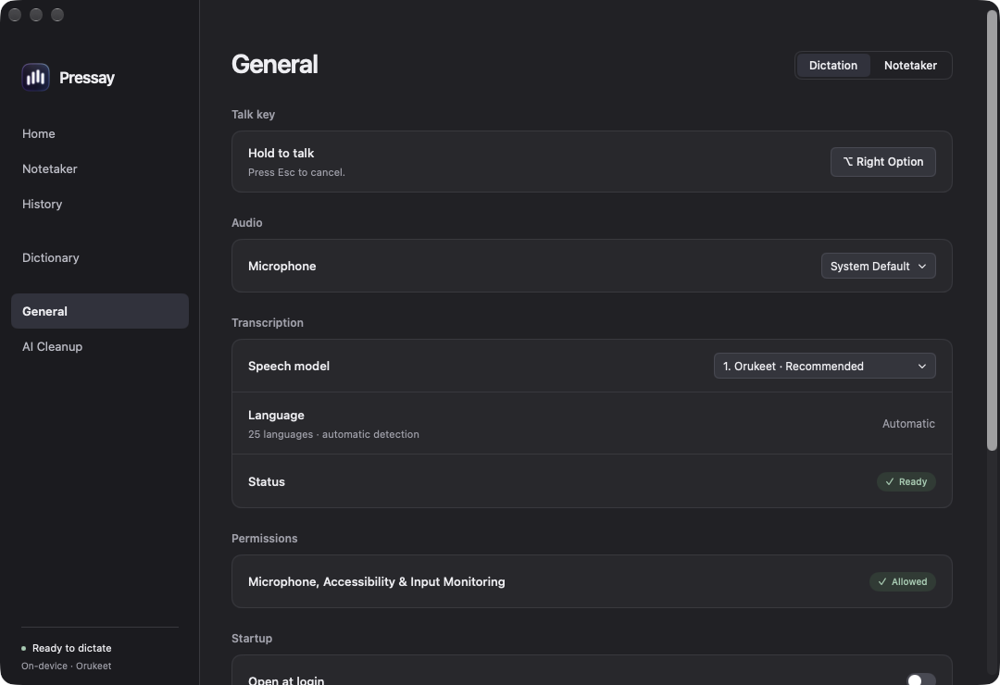 |  |
| Dictionary | 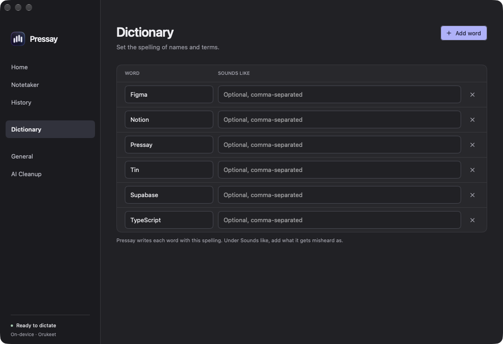 |  |
| History | 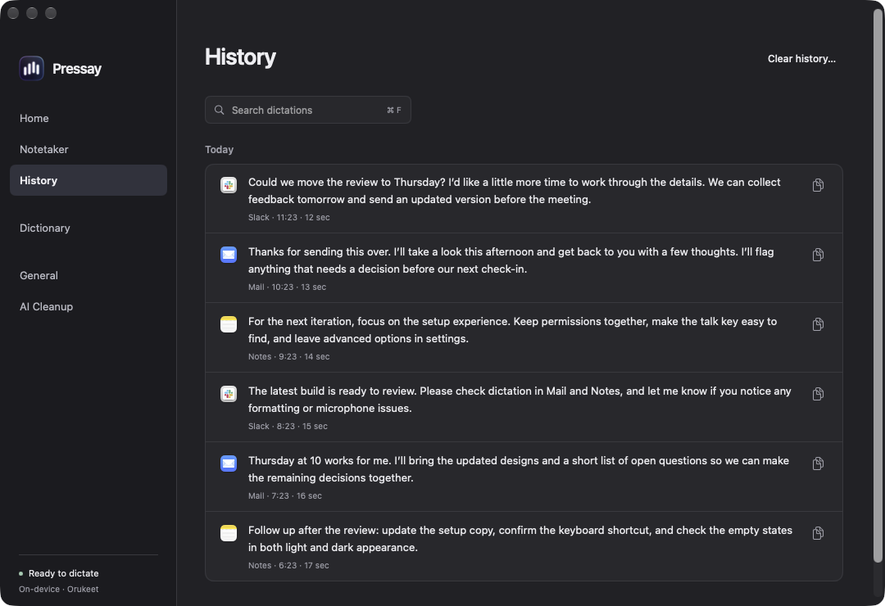 | 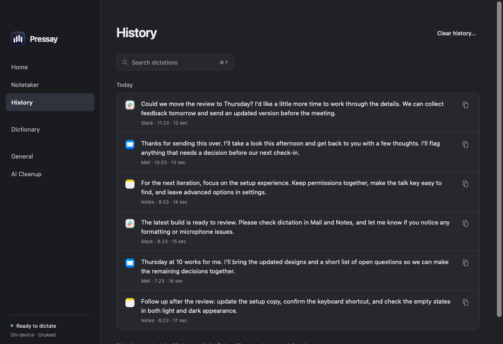 |
| Notetaker | 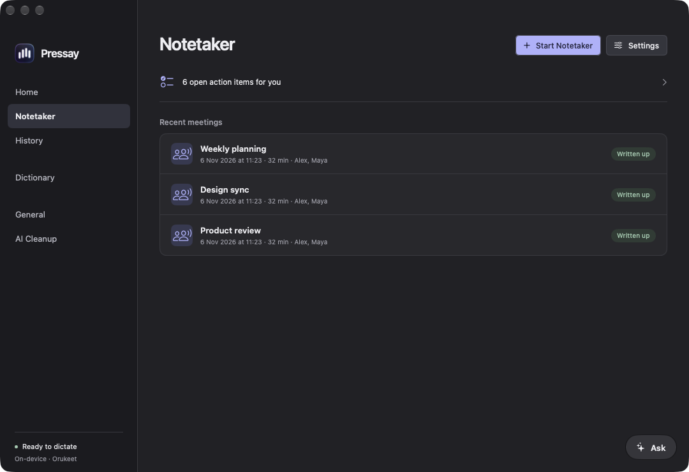 |  |
| AI Cleanup | 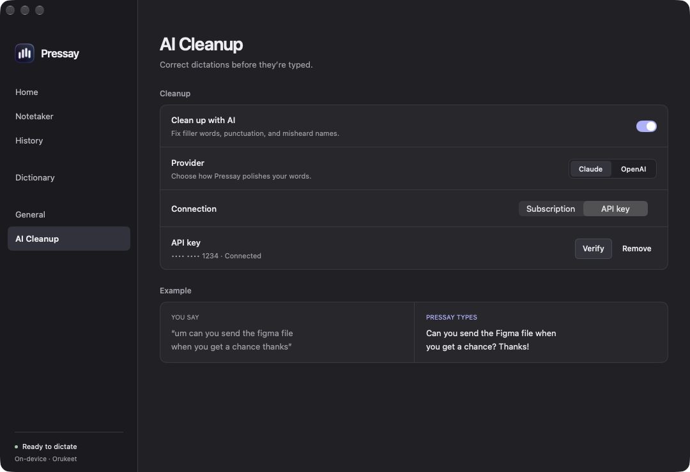 | 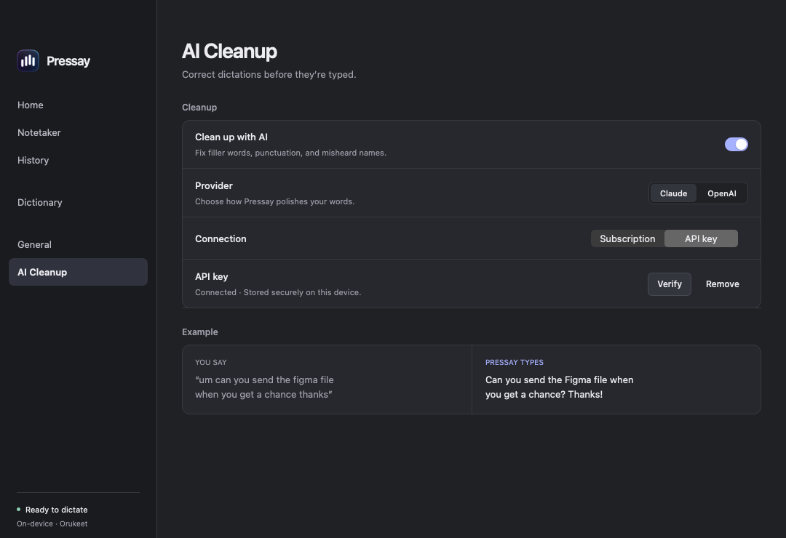 |
| Ask | 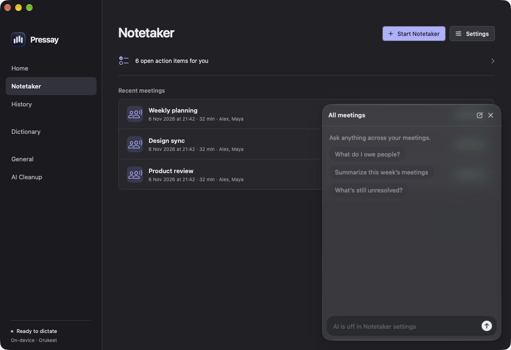 | 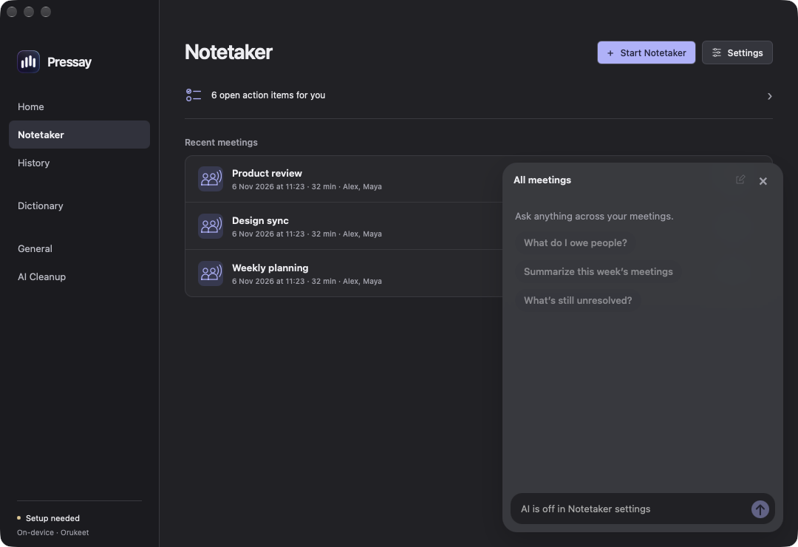 |
| Setup | 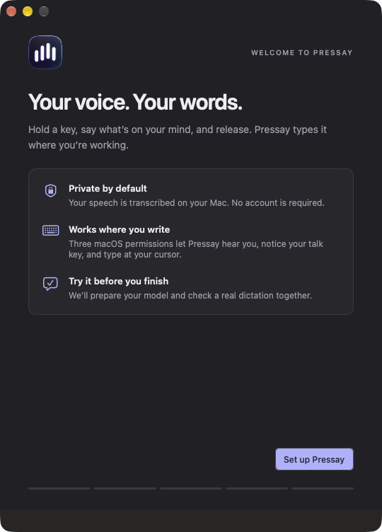 |  |
| Tray | 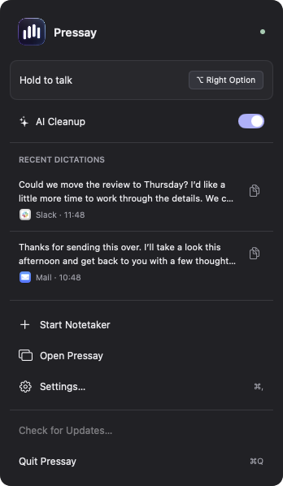 | 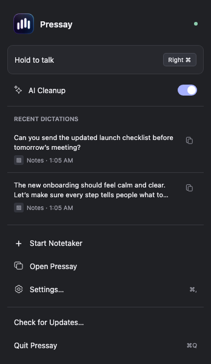 |


These screenshots contain synthetic/empty content and no credentials or private transcripts. A WebView tree or automated accessibility scan does not substitute for a screen-reader/IME session.

All staged Mac executables and runtime libraries are checked against the declared macOS 26 minimum before packaging. The check rejected a runtime accidentally built for macOS 27; rebuilding with an explicit deployment target passed. Silent output prewarm and owned-thread shutdown passed without playing a cue.

Signing/updater tests use ephemeral keys or disposable ad-hoc app copies. Missing notary profiles and unsuitable certificates fail when notarization is explicitly requested. Actual Developer ID/Azure signing, Apple submission/stapling and a published trusted desktop update installation remain external release acceptance work; see [release setup](releases.md).

## Outstanding acceptance

Full physical-device validation remains open on macOS, Windows and Linux: clean install/upgrade/uninstall, microphone and remote audio, denied/revoked/regranted permissions, hold/release → recognition → actual insertion, secure/custom editors, focus/overlay behavior, IMEs, screen readers, Bluetooth route changes, long meetings, lock/sleep and rollback. Mock provider/account tests do not replace real supported browser consent and provider sessions. Call detection is heuristic; task/reminder export needs target-application acceptance.

The [architecture decision](architecture/001-shared-rust-core.md) describes the implemented surface and platform constraints. The Rust app now uses the `dev.localflow.app` identity with its own store; the native Swift app's data remains available for rollback while these gates are verified.
