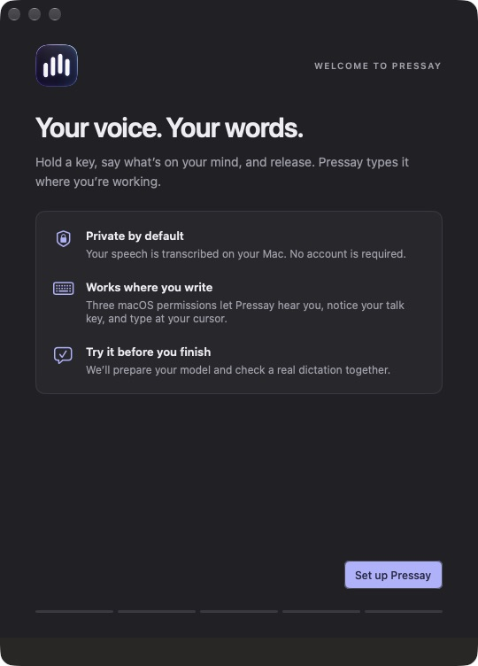
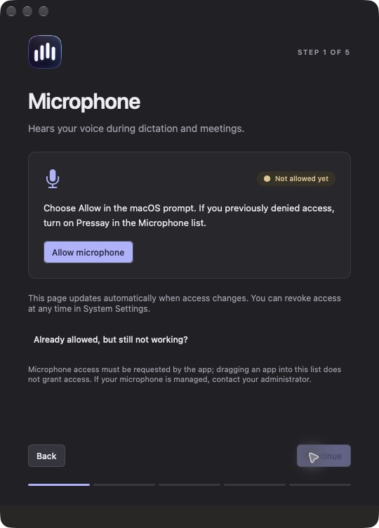
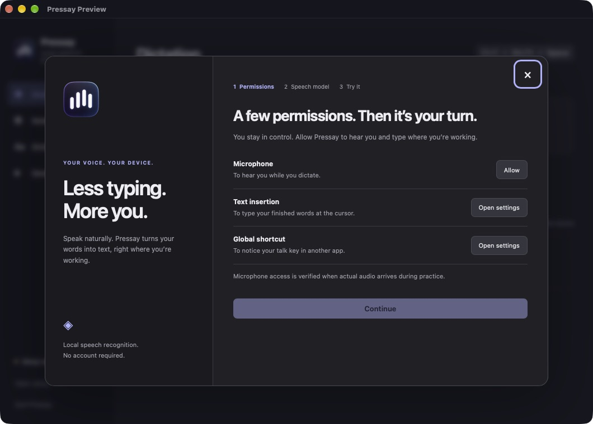

# Cross-platform migration validation

Recorded 2026-11-06 for the isolated preview and native Mac onboarding changes.
This is evidence for specific components, **not completion of issue #31**.

## Automated checks

- Apple Silicon/macOS 26: full Swift suite, **166 tests passed** (132 XCTest,
  19 core Testing tests, 15 onboarding/settings/migration Testing tests).
- Apple Silicon/macOS: Rust workspace, **40 tests passed**; strict Clippy passes.
- Ubuntu 24.04 ARM64 container: full Rust workspace, **40 tests passed**; strict Clippy and formatting pass.
- JavaScript syntax checks pass. Native Swift app builds and verifies its nested
  code signature. The Tauri app and DMG package successfully on Apple Silicon.
- Native DMG mounted-image validation checks the Applications symlink, Finder
  window/icon positions, 1×/2× background, and nested app signature.
- Missing notary profiles and non-Developer-ID signatures fail when notarization
  is explicitly requested. Actual Apple submission/stapling was not exercised.

Rust regression coverage includes resident-worker reuse and model/path changes,
real child-process cancellation/kill/reap, deadlines, crash recovery, oversized
and malformed replies, repeated truncation, chunk order, checksum/path validation,
offline verified caches, transactional migration, newer-schema preservation,
queue saturation, stale key events, first-sample readiness, audio overflow,
shutdown, and anti-aliasing/sample-length behavior from 8–192 kHz.

Migration tests export 501 old records without retention deleting any, compare
History.store/WAL/SHM and notes byte-for-byte, preserve raw models and legacy
vocabulary, exclude credentials, require mode-0600 output, and prevent exporting
over source data through direct paths or symlinks. No real user history was
exported for these tests.

## Real recognition smoke tests

The public upstream `samples/jfk.wav` clip was replayed through the real worker,
with the pinned model artifacts and native runtime. Both engines returned the
complete expected JFK sentence with `truncated:false`; stdout contained JSON
protocol only. No private recordings were used.

- macOS Orukeet: 0.159 s reported decode.
- macOS MOSS: consecutive requests around 0.476–0.486 s; newly packaged Metal
  runtime smoke 0.458 s.
- Ubuntu ARM64 CPU MOSS: consecutive requests 10.60 s and 10.91 s; process
  startup, warmup and both requests together took 30.88 s in the 6 GB container.

These runs use different hardware/backends and do not compare UI frameworks.
They are smoke observations, not benchmark-quality latency claims. They do not
measure microphone opening, insertion visibility, recognition quality across a
corpus, idle/peak RAM, sustained CPU, or power.

## Visual/native inspection

The packaged Tauri app launched, exposed its initial UI through the macOS
accessibility tree, and prepared the bundled Orukeet runtime from verified cached
weights. Opening setup before grants leaves Continue disabled. The native Swift
welcome and microphone guidance were inspected using the existing debug design
fixture in a separate bundle identity; fixture status is not a real OS grant.

Screenshots contain synthetic/empty app content. No private transcripts or
credentials are included. The browser/WebView accessibility tree is not a
substitute for actual screen-reader and IME testing.

## Outstanding acceptance

No Windows machine was available locally. Windows native builds/tests are
configured in PR CI, and installer builds have a separate manual workflow.
Linux container tests do not validate physical audio, a compositor, or input
into real applications. Full clean-machine install/upgrade/uninstall,
denied/revoked/regranted permission recovery, real microphone → recognition →
insertion practice, screen readers, IME, and focus/overlay behavior remain
unverified on supported machines. Signing/notarization credentials are external
setup requirements.

The [architecture decision](architecture/001-shared-rust-core.md) lists the
unported product features. In particular, portable dictation does not establish
meeting capture, provider/account cleanup, Wayland, or updater parity. The
complete Swift app remains the production release.
