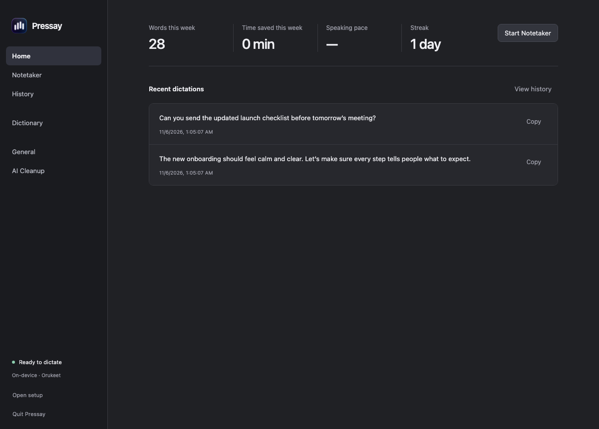
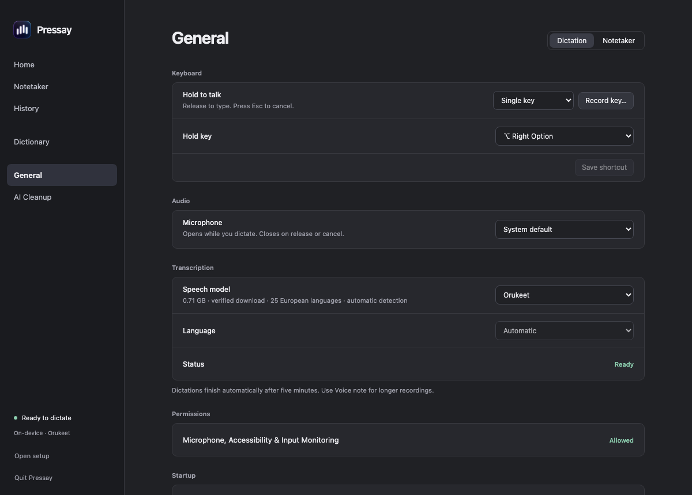
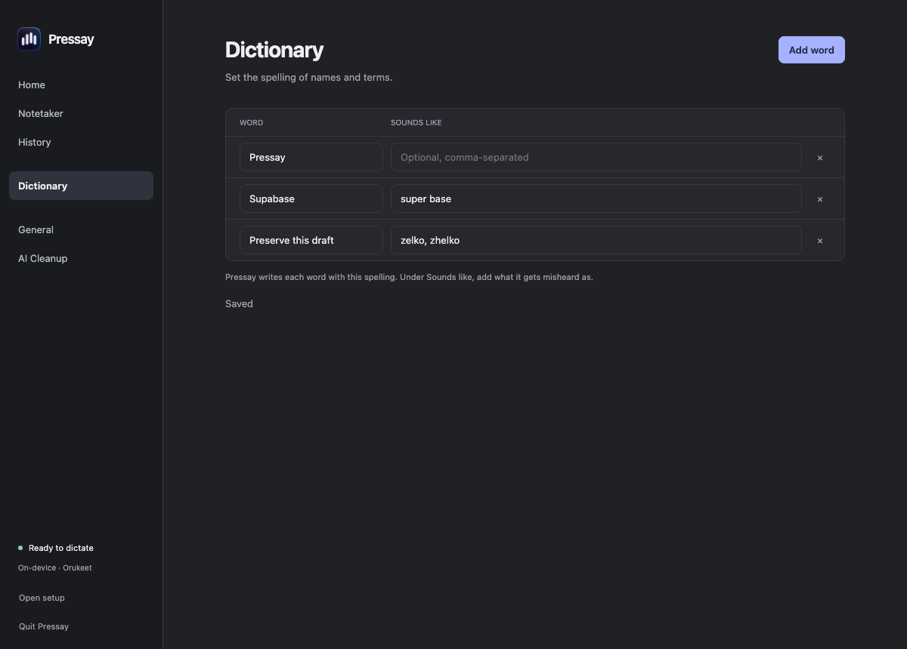
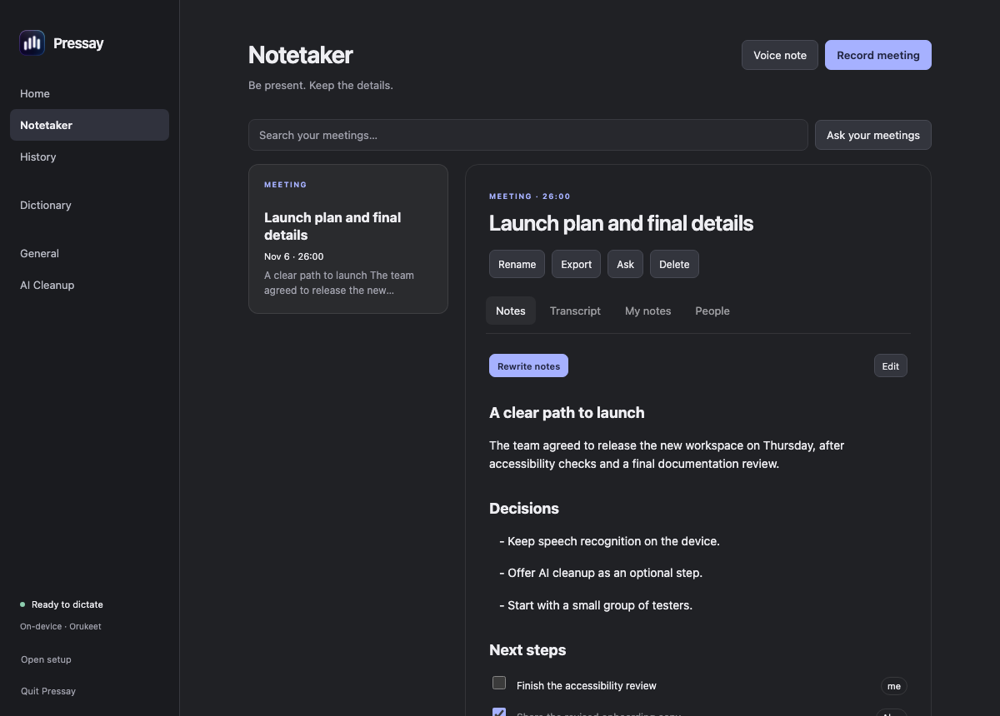
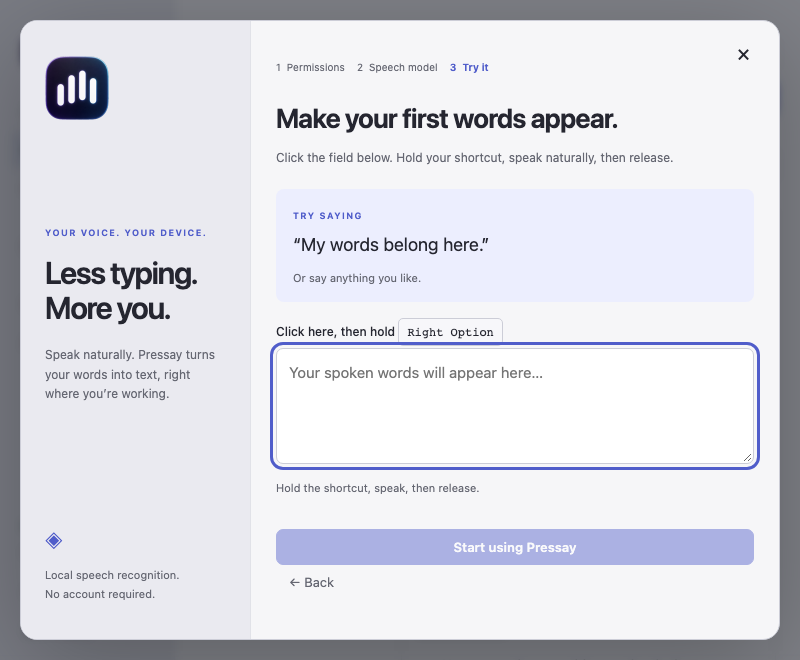

# Cross-platform migration validation

Recorded 2026-11-06 for the isolated preview and native Mac onboarding changes. The feature surface now includes notes, AI/account integration, live meetings, speaker analysis, Wayland portals and the existing Mac Mega-ASR worker. This record distinguishes implemented code, component evidence and physical acceptance that remains open; it is not a claim that issue #31 has completed all release QA.

## Automated and integration checks

- Native Mac onboarding/migration baseline: 166 Swift tests passed (132 XCTest, 19 core Testing tests, 15 onboarding/settings/migration tests). This count records that run, not a fixed total for subsequent revisions.
- Rust tests cover model download integrity, worker reuse/cancellation/reaping, malformed replies, truncation recovery, migration/retention, credential and provider protocols, notes/action items, queue saturation, stale input events, audio resampling, deadline clipping, VAD timing and shutdown. Exact current workspace totals belong to the PR's CI run.
- An Ubuntu 24.04 ARM64 integration snapshot passed 129 workspace tests and strict Clippy, plus the separately enabled Xvfb insertion test (130 total). Later parity additions are outside that snapshot; it does not validate the final source revision. The CI matrix also targets macOS and Windows.
- Focused meeting checks pass for partial/aligned VAD flush, route-gap origins, hysteresis/frame order, 12-second utterances, exact lead/tail timing, first-appearance voice numbering and majority overlap. Capture tests include real helper-process stop/drain/drop and final-duration clipping accepted by the bounded audio spool.
- Analysis lifecycle tests kill and reap a cancelled or malformed worker. Spool tests verify owner-only files, sparse timeline gaps, duration bounds, deletion and locked orphan cleanup that preserves active files and unrelated paths.
- A later Mac run passed 57 desktop tests and 77 core unit tests plus core integration suites. Added coverage includes current/stale call binding, two-minute warning timing, silent/discarded note handling, pending-write-up eligibility/idempotence, deletion beyond the UI's 10,000-row history limit, and seven-day orphan-audio cleanup preserving referenced files and links. Later changes still require their own CI run.
- JavaScript syntax checks pass. Axe reported zero WCAG 2A/2AA/2.1AA violations on Home, notes, Dictionary, General and onboarding using the real UI JavaScript with mocked IPC. This does not test a screen reader or native WebView accessibility end to end.

Migration tests export 501 original records without retention deleting any, compare History.store/WAL/SHM and notes byte-for-byte, preserve unknown models and legacy vocabulary, exclude credentials, require mode-0600 output, and prevent overwriting source data through direct paths or symlinks. No real user history was exported for these tests.

## Recognition preservation

A public FLEURS replay compared the Rust worker with the original Swift worker using the same pinned Orukeet and MOSS artifacts: six clips in English, French, German, Spanish, Japanese and Chinese, plus an English → one-second silence → French composition. **All 14 paired outputs matched exactly across 28 runs.** The sanitized [replay artifact](benchmarks/cross-platform-worker-replay.json) includes human references, source IDs, PCM hashes, model checksums and individual results.

Source audio and references are from [Google FLEURS](https://huggingface.co/datasets/google/fleurs), licensed CC BY 4.0; attribution and conversion details accompany the artifact. These are public fixtures, not private recordings. Equality demonstrates preservation for this sample, not general accuracy: Orukeet's Japanese/Chinese output remained poor in both hosts, while MOSS produced the corresponding scripts. No new language support is inferred from a shared wrapper.

Earlier public JFK smoke tests also exercised real native decoding with JSON-only protocol stdout:

| Environment | Observation |
| --- | --- |
| macOS Orukeet | 0.159 s reported decode |
| macOS MOSS | Consecutive requests around 0.476–0.486 s; packaged Metal smoke 0.458 s |
| Ubuntu ARM64 CPU MOSS, 6 GB container | 10.60 s and 10.91 s requests; startup/warmup/two requests together 30.88 s |

Those observations use different hardware/backends. They are not framework comparisons or benchmark-quality end-to-end latency measurements. They exclude microphone opening, editor visibility and sustained power/thermal behavior.

## Background dictation replay

A disposable harness ran the production streaming session with real native Orukeet/MOSS workers and Silero, feeding irregular 4,093-sample packets from public FLEURS English/French clips. An English → one-second silence → French fixture with uniform 4× gain (no clipping) and 100 ms of final silence lasted 20.12 seconds. The first cut was at 9.024 seconds; the final 384-sample VAD remainder was retained. The first real ASR reply arrived before the sender closed, one ASR process per model handled all requests, and the workers were reaped.

Orukeet's streamed and whole-clip outputs matched on 39 normalized words, with punctuation differences. MOSS streaming retained 39 words versus 38 whole-clip words, adding the French “et” omitted by whole-clip decoding. The unamplified fixture exposed inherited behavior: every French frame was below the existing RMS 0.003 trim threshold, so whole-clip trimming removed that quiet tail. Preserving Swift's trimming rule does not establish reliable recognition of very quiet speech.

Observed native whole/tail inference was 122.3/48.4 ms for Orukeet and 645.5/385.9 ms for MOSS. Accelerated packet-feed release-to-result was 389/717 ms, including queue catch-up; these are not real-time microphone or visible-insertion benchmarks. Audio provenance is Google FLEURS `en_us` row 1904 and `fr_fr` row 1987, using the pinned models recorded in the [public replay artifact](benchmarks/cross-platform-worker-replay.json). No private audio, microphone or credentials were used. The harness also caught a stale release binary that rejected the language field; rebuilding the ASR/analysis workers resolved it.

The nine-model catalog and language-selection contracts have automated coverage. This replay exercises Orukeet and MOSS only; it does not establish fresh inference validation for every restored Other model. The five-minute capture bound has a crossing-tail test and automatically stops/transcribes instead of dropping the recording. Imported audio is subject to the same bound.

## Speaker analysis and memory

The real Silero worker classified 234/344 JFK frames as speech. Streaming with 777-sample chunks exactly matched 160,000-sample chunks, and independent silent-track state stayed below 0.1 speech probability. The checked-in Sortformer frontend patch matched the original on 15,096,960 mel values with zero difference and retained identical IDs/timestamps on the public two-speaker fixture.

A three-hour silent recording completed analysis in 37.20 seconds at 819,488 KiB peak RSS; eight hours completed in 99.95 seconds at 1,919,632 KiB. These Apple Silicon/Metal measurements include evictable file-backed PCM pages, so they are not constant-memory or real-meeting accuracy claims. The original whole-clip frontend exceeded 3.4 GiB almost immediately in the three-hour test and was stopped. Detailed provenance, bounds and reproduction commands are in [portable meeting validation](portable-meeting-validation.md).

## Native integration evidence

| Area | What was exercised | What it does not establish |
| --- | --- | --- |
| Linux X11 | Xvfb + real libxdo generated key events; clipboard selection ownership stayed unchanged; WM_CLASS target identification and focus-change refusal passed | Real application/IME behavior, every clipboard format or physical desktop acceptance |
| Linux portals | Private `dbus-daemon` with a mock portal exercised production wire serialization, early responses, hold/release, Unicode key press/release, control-text refusal and revocation with no further insertion | Actual GNOME/KDE consent, compositor policies, layouts or real Wayland editor insertion |
| Mac MLX resources | A relocated app probe linked the exact Cmlx object used by the Swift worker and completed a real Metal 1,024-element vector addition; removing its adjacent resource bundle caused the expected failure, restoring it passed | Mega-ASR model loading, transcription accuracy or full model inference |
| Mac input/overlay | Real Preview Microphone, Input Monitoring and Accessibility grants recognized in onboarding; native code checks, synthetic CGEvent objects without posting input, and AppKit structure checks for nonactivating/click-through overlay and interactive guide | Physical hold/release, lock behavior or insertion into an editor are separate acceptance checks |
| Windows native adapters | Cross-target API checks cover capture/platform/session integration | A Windows runtime, real WASAPI devices, UAC/editor behavior or clean-machine acceptance |

Native capture includes Mac CoreAudio taps, Windows WASAPI loopback and Linux PulseAudio/PipeWire monitor processes. Their implementation and fixture tests do not establish actual device routing, Bluetooth behavior or echo quality. Mac has voice-processing fallback; Windows/Linux adapters currently lack echo cancellation. Linux alignment uses monotonic/sample-count timing rather than validated shared hardware clocks.

Useful Linux integration commands:

```sh
cargo test -p pressay-desktop --locked wayland
xvfb-run -a cargo test -p pressay-desktop --locked x11_insertion -- --ignored --nocapture
```

First-run integration checks caught and fixed missing updater configuration and synchronous microphone enumeration. Native enumeration now reads CoreAudio metadata without opening an audio unit. With explicit user approval, the packaged Preview received Microphone, Input Monitoring and Accessibility access. All three grants were recognized by onboarding after removing/re-adding obsolete ad-hoc Accessibility and Input Monitoring entries and reopening Preview; tightly scoped TCC logs confirmed a code-requirement mismatch. The original app’s permission entries were left intact. The Preview used an isolated disposable profile and no account credentials. The rebuilt app loaded the verified cached Orukeet model and reached practice with all three permissions recognized. A separate `Control+Shift+Space` shortcut was seeded in the disposable profile while Preview was stopped to avoid activating the original app; this does not validate the physical shortcut recorder. AppleScript/System Events provided UI inspection after the native control service failed. A live spoken practice response is still pending; microphone-to-editor acceptance is not claimed.

The UX follow-up preserves the original six destinations, Home metrics/recent dictations, editable Dictionary rows, General Dictation/Notetaker tabs and connected-account notes controls. Tests run the actual UI against synthetic IPC and exercise failed-save draft retention, shortcut recording/cancellation, missing microphone identity, recovered permissions, and selected-model preparation gates. Meeting cancellation tests verify that skipping speaker separation preserves the completed transcript and automatic write-up, while cancellation before transcription completes discards the recording. These component checks do not establish physical microphone/editor or audible-cue acceptance.

## Packaging and visual inspection

Native Swift app builds and nested-signature verification passed. The native DMG validation checks its Applications symlink, Finder geometry, 1×/2× background and nested signature. The final desktop build produced a sealed Mac app and branded DMG. Strict deep signature checks, the app resource seal, all 38 bundled Mach-O deployment versions, the DMG checksum and mounted Finder-layout checks passed. Constructing an installer is not proof of consent or upgrade acceptance.

An earlier packaged preview launched, exposed its initial accessibility tree and prepared Orukeet from verified cached weights. The native welcome/microphone guide was inspected through a separate debug fixture; simulated fixture status is not an OS permission grant. Real UI JavaScript has also been inspected with mock data in dark/light and narrower layouts.








These screenshots contain synthetic/empty content and no credentials or private transcripts. A WebView tree or automated accessibility scan does not substitute for a screen-reader/IME session.

All staged Mac executables and runtime libraries are checked against the declared macOS 26 minimum before packaging. The check rejected a runtime accidentally built for macOS 27; rebuilding with an explicit deployment target passed. Silent output prewarm and owned-thread shutdown passed without playing a cue.

Signing/updater tests use ephemeral keys or disposable ad-hoc app copies. Missing notary profiles and unsuitable certificates fail when notarization is explicitly requested. Actual Developer ID/Azure signing, Apple submission/stapling and a published trusted desktop update installation remain external release acceptance work; see [release setup](releases.md).

## Outstanding acceptance

Full physical-device validation remains open on macOS, Windows and Linux: clean install/upgrade/uninstall, microphone and remote audio, denied/revoked/regranted permissions, hold/release → recognition → actual insertion, secure/custom editors, focus/overlay behavior, IMEs, screen readers, Bluetooth route changes, long meetings, lock/sleep and rollback. Mock provider/account tests do not replace real supported browser consent and provider sessions. Call detection is heuristic; task/reminder export needs target-application acceptance.

The [architecture decision](architecture/001-shared-rust-core.md) describes the implemented surface and platform constraints. The isolated preview retains its own identity/store; the native Swift app remains available for rollback while these gates are verified.
