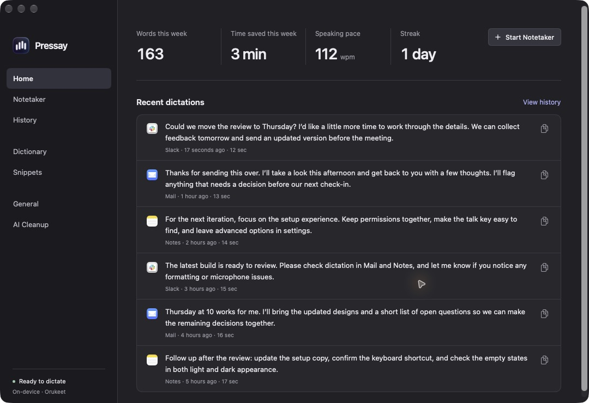
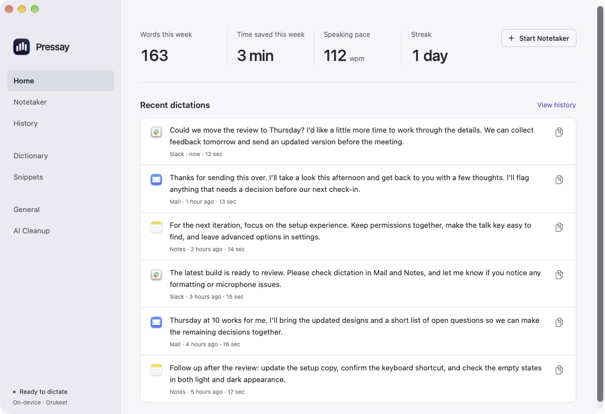
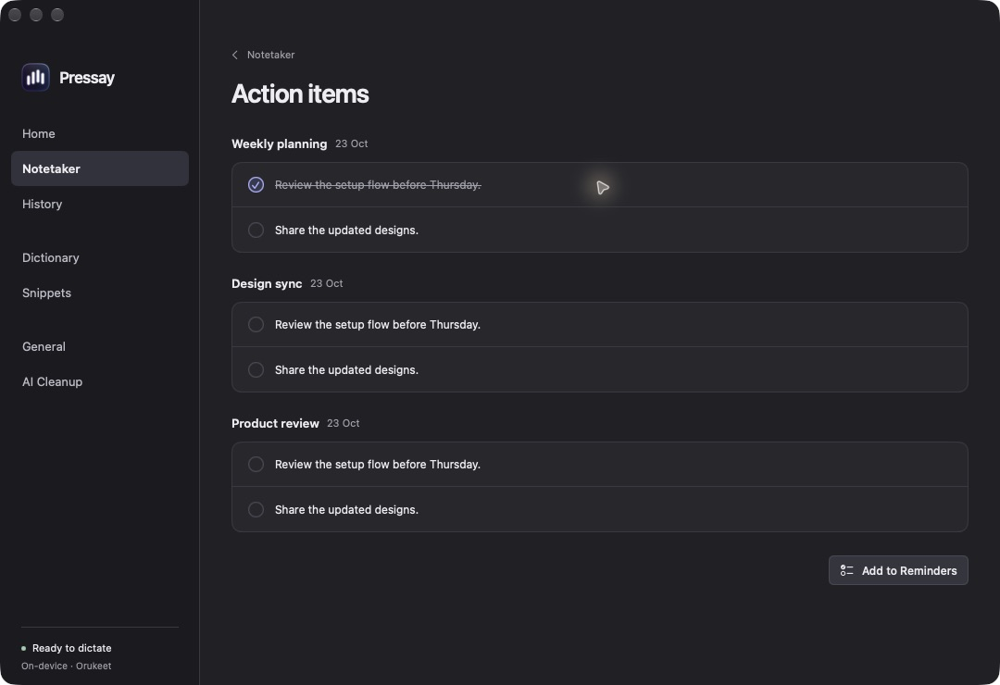
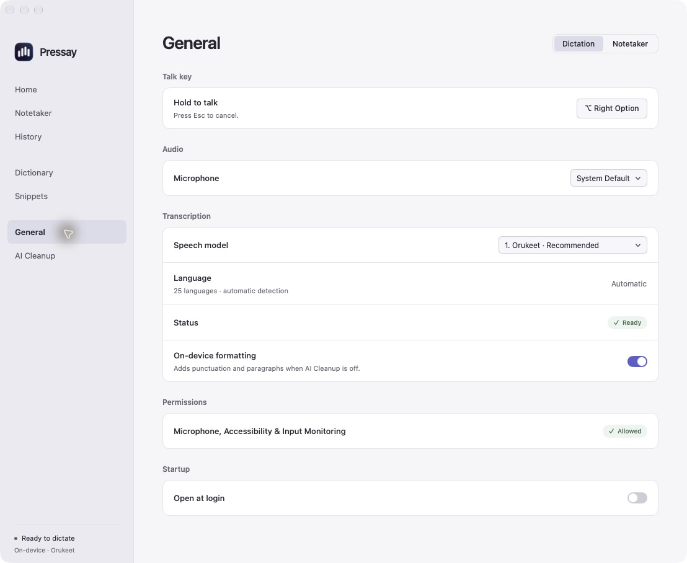
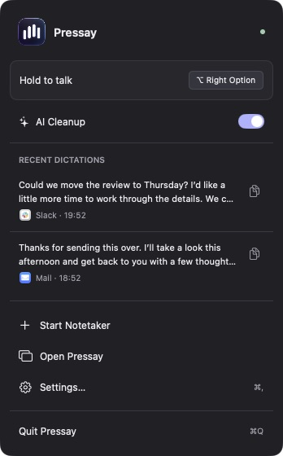
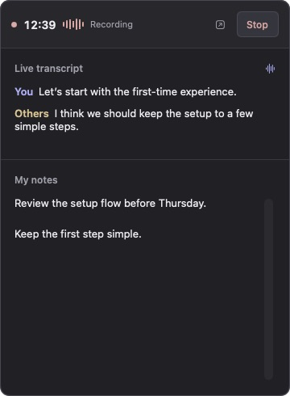
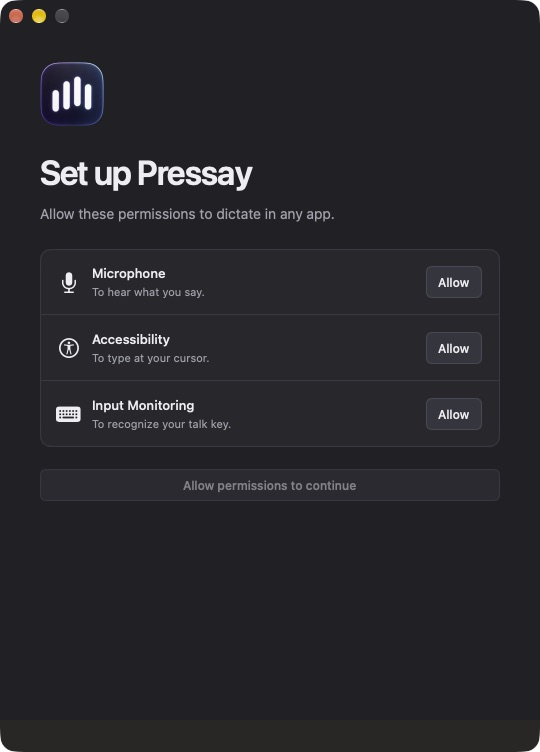
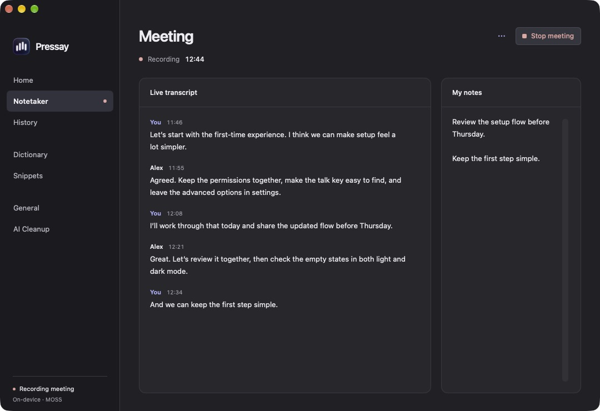
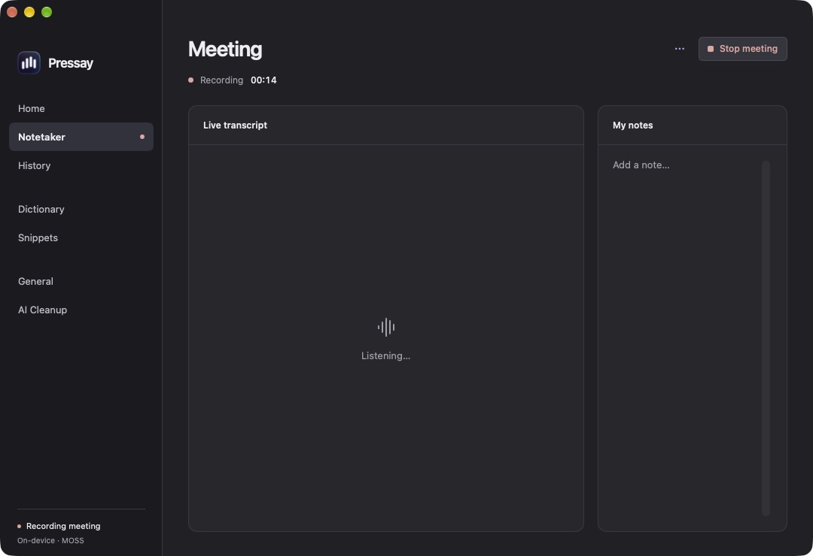
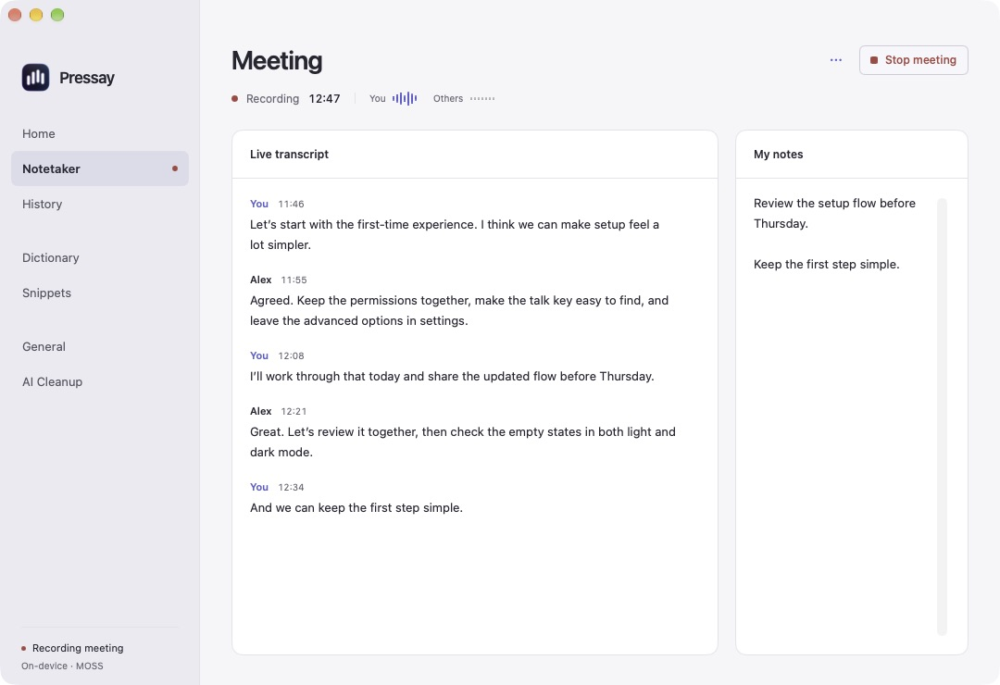

# Graphite redesign

The native SwiftUI/AppKit implementation follows the approved Graphite canvas in both appearances. The canonical reference is [`designs/pressay-macos/project`](../designs/pressay-macos/project); [`review.html`](../designs/pressay-macos/review.html) provides an offline screen browser. The canvas contains 42 dark screens and their 42 light counterparts.

Shared tokens, controls and spacing live in `PressayDesign.swift`. The main window starts at 1080 × 740, with a 216-point text sidebar. Content, editors, confirmations, onboarding, menu bar and the floating meeting widget use the same palette. Real app icons come from the existing cached `NSWorkspace` lookup.

The saved note reader and summary/transcript rendering are byte-identical to the original protected region. The live recording workspace follows the subsequently approved live meeting artboards. `OverlayPanel.swift`, including the transcription notch animation, is unchanged.

## Product changes

| Area | Result |
| --- | --- |
| Home | Weekly words/time saved, speaking pace, streak and six recent dictations with longer excerpts. |
| Action Items | Personal tasks with circular completion controls. Other assignments remain in meeting notes. |
| Dictionary | Preferred spelling only; background learning replaces suggestions. Manual words persist; explicit removals are respected; contradictory or stale learned rules retract. |
| Snippets | Compact phrase → text rows and concise Add/Edit forms. |
| General | Dictation and Notetaker tabs combine audio, language, ranked models and recording preferences. |
| Removed features | Microphone warming, app-specific writing styles and Command Mode, including their processing paths and preferences. |
| Copy | Removed the requested privacy claims, redundant headers, promotions and helper lines. |

All speech models default to automatic detection. Fixed language choices are available only on runtimes that accept them: Whisper (100), Voxtral (8), Fun-ASR MLT (31). The installed Qwen runtime supports automatic detection across 30 languages but rejects fixed hints. Meeting transcription has its own model/language preference. English-only cleanup heuristics are gated by the selected language or on-device language recognition so foreign repetitions are preserved. Model capability references are in [`model-capabilities.json`](../designs/pressay-macos/model-capabilities.json).

## Verification

- `make test`: 172 tests passed (137 Core XCTest, 6 transcription XCTest, 22 Core Swift Testing, 7 app settings/learning tests).
- `make app`: release build and bundled native ASR runtime succeeded; signed with the existing local signing identity.
- 20 synthetic speech checks: English and German through all nine models, Japanese through Qwen 1.7B and Whisper. All completed successfully with automatic language detection. [Outputs](assets/redesign/asr-smoke.json) are smoke evidence, not an accuracy ranking.
- Native interaction checks: navigation; history search using ⌘F; dictionary validation/save; Add/Edit snippet forms; personal task completion and undo; ranked model menu; Whisper language list and Japanese selection; switching to Qwen resets to Automatic; onboarding permission progression and completion; meeting widget Open navigation; empty state.
- Native screenshots use isolated synthetic content. Both appearances, the menu bar, onboarding, live meeting workspace and recording widget were inspected against the canvas. System menus, scrollbars, traffic lights and focus rendering follow macOS preferences.
- Saved note reader checked byte-for-byte; `git diff --check` and the 84-artboard design validator passed.

Final hardware QA used the installed profile with synthetic speech: webcam microphone → Orukeet → automatic insertion into TextEdit and Stickies; MOSS meeting capture from system audio; live transcript, personal notes and Stop/save. The existing Claude connection verified successfully. Temporary QA dictations/meetings were removed and original preferences restored. The MacBook was in clamshell mode, so its built-in microphone returned silence; dictation used the webcam input.

**Bluetooth capture, physical modifier-only hotkey dispatch, ChatGPT browser sign-in and Reminders writes were not exercised.** Automation sends key events directly to apps and cannot reproduce a physical modifier-only global hotkey. The microphone/transcription/insertion pipeline was invoked with a temporary debug trigger that is absent from release source and binaries.

Live hardware QA also caught delayed system-audio startup leaving a stale permissions warning, and MOSS returning raw timing markers despite timestamps being disabled. The warning now clears when audio arrives. MOSS metadata is removed before text enters either dictation or meeting transcripts; literal bracketed text and other models are preserved. The [model’s documented segment format](https://huggingface.co/docs/transformers/en/model_doc/moss_transcribe_diarize) explains those markers.

## Audit and OpenAI Docs

Removed redundant catalog/count assertions, the retired-preference deletion test, and comments that restated names or control flow. Migration, multilingual text preservation, correction evidence, explicit removals and credential storage remain covered.

The [official Sign in with ChatGPT guide](https://developers.openai.com/siwc/token-sharing-open-source/sign-in#4-validate-the-id-token-and-chatgpt-plan-permission) requires a returning account’s verified identity to match before credentials are replaced. Returning sign-in now checks the saved subject in addition to signature, issuer, audience, nonce and expiry. A filesystem integration check verifies first-use credential creation, rotation, owner-only permissions and stable host identity. Request fields match the [documented ChatGPT-plan Responses API requirements](https://developers.openai.com/siwc/token-sharing-open-source/preview-limitations#responses-api-requirements).

## Screenshots

| Dark | Light |
| --- | --- |
|  |  |
|  |  |

| Menu bar | Recording widget | Onboarding |
| --- | --- | --- |
|  |  |  |

## Live meeting workspace

The live view uses a plain speaker/timestamp transcript and a separate notes panel. Recording status, elapsed time and Stop sit in the content header. Discard is in the More menu and requires confirmation. The transcript follows new turns until the user scrolls back; Latest returns to the end. The timer freezes, controls disable and notes become read-only while transcription finishes. Saved-note rendering is preserved.

Listening uses a subtle five-bar waiting animation rather than a simulated audio level. Reduce Motion pauses it on a static waveform and disables animated jumps to the latest transcript. The canvas has matching dark/light recording, listening and finishing artboards.

| Recording | Listening |
| --- | --- |
|  |  |



## Reproduce the native visual review

Build a debug app with `CONFIGURATION=debug scripts/build-app.sh`. Run its executable in a separate review bundle/identity to avoid colliding with an installed Pressay instance:

```sh
open -n /path/to/Pressay-Review.app \
  --env PRESSAY_DESIGN_REVIEW=1 \
  --env PRESSAY_REVIEW_APPEARANCE=dark \
  --env PRESSAY_DEMO=settings \
  --env PRESSAY_PANE=home \
  --env PRESSAY_NO_KEYCHAIN=1
```

Review mode is compiled only in DEBUG. It uses an isolated defaults suite, in-memory history, temporary meeting notes and synthetic fixtures. It skips hotkeys, model loading, provider credentials, login registration and system permission requests. Use `PRESSAY_REVIEW_APPEARANCE=light`, `PRESSAY_REVIEW_EMPTY=1`, or `PRESSAY_REVIEW_PERMISSIONS=missing` for variants; `PRESSAY_DEMO` also accepts `menu`, `onboarding`, `notepad` and `call`. With `notepad`, use `PRESSAY_REVIEW_MEETING_STATE=listening|recording|finishing|long` to inspect live states; `PRESSAY_REVIEW_REDUCE_MOTION=1` renders a static listening waveform without changing macOS settings.
